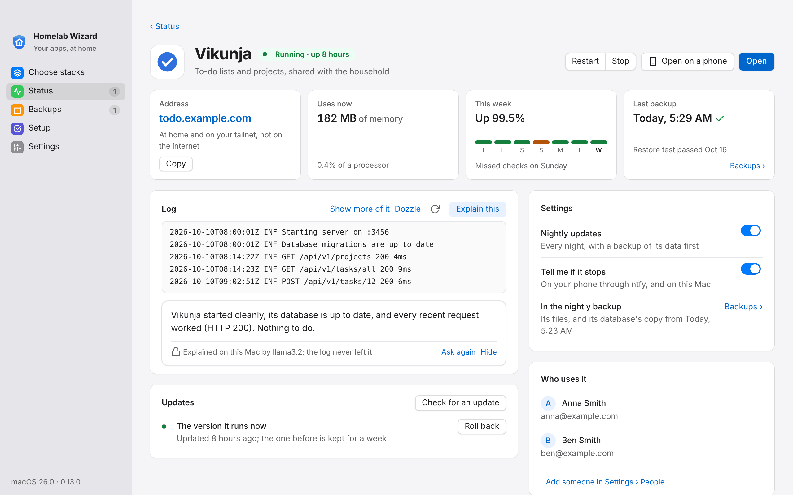

<p align="center">
  
</p>

<h1 align="center">Homelab Wizard</h1>

<p align="center">
  <strong>Your household's photos, passwords, documents, money, music, and books, on a computer you own.</strong><br>
  A desktop app and a small CLI that install, connect, back up, update, and watch over 70+ self-hosted apps.
</p>

<p align="center">
  <a href="https://github.com/Snooper42/homelab-wizard/releases"></a>
  <a href="LICENSE"></a>
  
  
  
  
</p>

<p align="center">
  <a href="#get-started">Get started</a> ·
  <a href="#what-it-does">What it does</a> ·
  <a href="#everyday-tasks">Everyday tasks</a> ·
  <a href="#what-runs">Apps</a> ·
  <a href="#questions">Questions</a> ·
  <a href="#getting-help">Help</a> ·
  <a href="#documentation">Docs</a> ·
  <a href="CHANGELOG.md">What's new</a> ·
  <a href="docs/Roadmap.md">Roadmap</a>
</p>

<p align="center">
<picture>
  <source media="(prefers-color-scheme: dark)" srcset="docs/images/app-status-dark.png">
  
</picture>
</p>

> [!NOTE]
> **Beta.** Homelab Wizard runs a real household on a Mac, and it is now being tested on Windows and Linux machines too. The builds are not signed yet (no Apple Developer ID or Windows code-signing certificate), so each system asks once whether to trust them. Open problems are in [Known Issues](docs/Known%20Issues.md); what changed in each version is in the [CHANGELOG](CHANGELOG.md).

## Get started

### What you need

| | |
|---|---|
| **A computer that stays on** | A Mac (Apple Silicon or Intel), a Windows 10 or 11 PC (x64 or ARM), a Linux machine (Ubuntu 22.04+, Debian 12+, Fedora, Arch), or a Steam Machine. 8 GB of memory runs the *Start here* apps; 16 GB is comfortable for more |
| **A container runtime** | [OrbStack](https://orbstack.dev) on a Mac, Docker Desktop with WSL 2 on Windows, Docker Engine with its compose plugin on Linux. On SteamOS, Setup installs Docker in your home folder for you |
| **A free [Tailscale](https://tailscale.com) account** | Gives every app a private `https://` address on your own phones and computers, at home and away. No domain, no router changes, nothing published to the internet |
| Somewhere for backups (within the first week) | A cloud drive's synced folder (Proton Drive, iCloud Drive, OneDrive, Dropbox, Google Drive) or an external drive |
| Optional | An external drive for films, music, and photos; a domain on Cloudflare (about $11 a year) for short addresses and public apps; [Ollama](https://ollama.com) for **Explain this** on logs |

[Getting Started](docs/Getting%20Started.md) explains each one; [Host](docs/Host.md) has each system's details.

### Install

1. **Install the app** with one pasted line. On a Mac or Linux, in Terminal:

   ```sh
   curl -fsSL https://raw.githubusercontent.com/Snooper42/homelab-wizard/main/install.sh | sh
   ```

   On Windows, in PowerShell:

   ```powershell
   irm https://raw.githubusercontent.com/Snooper42/homelab-wizard/main/install.ps1 | iex
   ```

   Both download the newest build from [Releases](https://github.com/Snooper42/homelab-wizard/releases/latest), check it against GitHub's SHA-256 checksum, install it, and open it. The line is there because the builds aren't signed yet: a browser download gets blocked, a download from Terminal or PowerShell doesn't. Both scripts are short enough to read first ([install.sh](install.sh), [install.ps1](install.ps1)).
2. **Open it and choose Set it up for me.** It makes the homelab folder (`~/Homelab`), with a strong password for every app, and starts the essentials (updates, backups, alerts).
3. **Pick what you want** on Choose stacks (Photos, Passwords, Movies and TV, Music, Files, or anything from the full list) and click **Install**.
4. **Finish on Setup.** **Do the N I can do for you** runs every step that is ready; the rest say in one line what they give you. Signing in to Tailscale and installing it on your phones is the part only you can do.

You are done when Setup leaves the sidebar (it comes back by itself if a step comes undone) and every app on **Status** has a green dot. Then put Tailscale and the apps' own phone apps on each phone ([Getting Started › Set up each person's phone](docs/Getting%20Started.md#4-set-up-each-persons-phone)).

<details>
<summary><strong>Every download, and the command line</strong></summary>

| Platform | Download | Install |
|---|---|---|
| macOS (Apple Silicon and Intel) | [Releases › Latest](https://github.com/Snooper42/homelab-wizard/releases/latest) › `Homelab-Wizard-macOS.dmg` | `install.sh` (above). Or open the download, drag the app to Applications, and clear the download flag once: `xattr -dr com.apple.quarantine "/Applications/Homelab Wizard.app"`. Later updates install themselves |
| Windows 10 and 11, x64 or ARM | [Releases › Latest](https://github.com/Snooper42/homelab-wizard/releases/latest) › `Homelab-Wizard-Windows-Setup.exe` | `install.ps1` (above). Or run the download (SmartScreen: More info › Run anyway, while it's unsigned), or unzip the portable build. Later updates install themselves |
| Ubuntu, Debian, Fedora, Arch | Releases › Latest › `.deb`, `.rpm`, or `.pkg.tar.zst` | `curl -fsSL https://raw.githubusercontent.com/Snooper42/homelab-wizard/main/install.sh \| sh` picks the package and installs it; or `sudo apt install ./homelab-wizard_*.deb` (or `dnf install`, `pacman -U`). Later updates install themselves |
| SteamOS, or Linux without WebKitGTK | Releases › Latest › `Homelab-Wizard-x86_64.AppImage` | The same `install.sh` line (on SteamOS it puts the AppImage in `~/Applications`), or `chmod +x` and open it; Settings › This machine › **Add to the app menu** |

Every build carries the `homelab` CLI, so nothing else is needed. What each contains: [Releasing](docs/Releasing.md#each-platforms-build). Building it yourself: [app/README.md](app/README.md).

Prefer the command line? The same homelab from git, shown here on a Mac (on Linux, install Docker and Go from your package manager; on Windows, use `homelab.cmd`):

```bash
brew install --cask orbstack     # then OrbStack › Settings › Start at login
brew install go                  # ./homelab builds itself on first run
git clone https://github.com/Snooper42/homelab-wizard.git ~/Homelab
cd ~/Homelab
./homelab doctor                 # checks the machine, the runtime, and the settings
./homelab up                     # makes .env with generated passwords, starts the essentials
./homelab setup                  # the same checklist as the app's Setup screen
```

The [runbook](docs/Runbooks.md#first-time-bring-up) has every setup step as commands.

</details>

## What it does

A small private cloud on a computer at home. It does the jobs you would otherwise pay monthly subscriptions for, but the apps run at home and the files stay yours.

| When you want to… | Open | Instead of paying for |
|---|---|---|
| Back up phone photos and find them by face, place, or thing | Immich | iCloud+ 2 TB |
| Keep everyone's passwords | Vaultwarden (with the Bitwarden apps) | 1Password Families |
| Sign in to the apps with Face ID instead of a password per app | Pocket ID | a single sign-on service |
| Scan and search receipts, letters, and paperwork | Paperless-ngx | Evernote |
| Plan the budget, and track investments | MoneyMatter or Actual Budget, Ghostfolio | YNAB, a portfolio tracker |
| Watch your movies and shows | Jellyfin | Netflix and others, for what you own |
| Listen to your music, audiobooks, and podcasts | Navidrome, Audiobookshelf | Spotify Family, Audible |
| Read e-books and comics | Calibre-Web, Komga | Kindle Unlimited, Marvel Unlimited |
| Save articles, keep a household wiki, and see where you have been | Karakeep, Docmost, Dawarich | Pocket, Notion, Google Maps Timeline |
| Recipes, groceries, chores, and to-dos | Mealie, Grocy, Vikunja | Plan to Eat, a list app, Todoist |
| Run the lights, locks, sensors, and cameras | Home Assistant, Frigate | each device's own cloud app |
| Ask an AI assistant privately | Open WebUI | some ChatGPT use |
| Reach everything while away, with ads blocked | Tailscale, AdGuard Home | a VPN, NextDNS |

The apps are free, but each takes hours to set up by hand and has to be kept running, updated, and backed up. Homelab Wizard is the part that does that work:

| | |
|---|---|
| **Installs for you.** Pick apps; everything each one needs comes with it, and apps that work together are connected. | **Keeps watch, and heals.** Status changes the moment an app stops, hangs, or stops answering; an app that hangs is restarted by itself, and **Fix it** puts most other things right. A menu bar icon and phone alerts say so too. |
| **Backs up every night,** encrypted, to the cloud drive or external drive you pick, and proves a restore works once a month. Kopia can keep a second, independent copy. | **Updates overnight,** with a pause button. **Check for an update** shows the release notes first; a bad update is undone in one click, or by itself. |
| **One sign-in per person.** Settings › **People** gives each person an account, a welcome page, and a start page with their apps. | **Works from the phone.** A paired phone shows Status and Backups, and each app opens there from a QR code. |
| **Keeps itself current.** It finds updates by itself; one click updates the homelab and the app. | **Lets you leave.** Export everyone's data in open formats, move to a new computer, or print a recovery kit. |
| **Explains what went wrong.** With Ollama on the computer, **Explain this** says in plain words what an app's log shows and what to try; the log never leaves the house. | **Status on the wall.** A TV or a tablet paired in kiosk mode shows Status large, live, and without buttons. |

## Everyday tasks

Each in the app, then the same from a terminal in the homelab folder (`homelab.cmd` on Windows).

| To… | In the app | In a terminal | More |
|---|---|---|---|
| Add an app | Choose stacks › tick it › **Install** | `./homelab install <app>` | [Services](docs/Services.md) |
| Open an app on a phone | Status › the app's page › **Open on a phone** (a QR code) | `./homelab status` lists the addresses | [Inventory](docs/Inventory.md) |
| Put right what is down | Status › **Fix it** (the plan first) | `./homelab fix` | [Troubleshooting](docs/Troubleshooting.md) |
| Read an app's log, in plain words | Status › the app's page › its log › **Explain this** | `./homelab logs <app> --explain` | [Monitoring](docs/Monitoring.md) |
| Update an app now, or undo an update | The app's page › **Check for an update**, or **Roll back** | `./homelab update <app>`, `./homelab rollback <app>` | [Automation](docs/Automation.md#watchtower-container-updates) |
| Pause the nightly updates | Status › *Nightly updates* › **Pause** | `./homelab updates pause` (and `resume`) | [Automation](docs/Automation.md) |
| Back up now, or prove a restore works | Backups › **Back up now**, **Test a restore** | `./homelab backup --apply`, `./homelab restore-test --auto` | [Backups](docs/Backups.md) |
| Update Homelab Wizard and the homelab | **Update now** on the line at the top of the window | `./homelab upgrade` | [Upgrading](docs/Upgrading.md) |
| Add someone in the household | Settings › **People** › **Add a person** | `./homelab person add "Anna Smith" --email anna@example.com` | [Pocket ID](<services/security/Pocket ID.md>) |
| Pair a phone with the companion | Settings › **Phones** › **Pair a phone** | `./homelab phone pair` | [Phone companion](<services/system/Phone companion.md>) |
| Use a domain of your own | Settings › `HOMELAB_DOMAIN`, then the new steps on Setup | `./homelab domain setup` | [Getting Started](docs/Getting%20Started.md#later-a-domain-of-your-own) |
| Move to a new computer | Backups › **Moving to a new machine** › **Move out…** | `./homelab move out --to <file>`, then `move in` there | [Disaster Recovery](docs/Disaster%20Recovery.md#scenario-moving-to-a-new-machine) |
| Print the recovery kit | Backups › **Recovery kit** | `./homelab recovery-kit` | [Disaster Recovery](docs/Disaster%20Recovery.md) |
| Ask for help | Settings › This Mac › **Make a diagnostics report** | `./homelab report` | [Getting help](#getting-help) |

## The desktop app

The same engine as the CLI, in a window that looks native on each system: the Mac's, Windows 11's, GNOME's, and KDE's (SteamOS). Every button works from the keyboard and with a screen reader, and Ctrl/⌘ plus and minus change the text size.

<table>
<tr>
<td width="50%"><strong>Choose stacks</strong><br>Pick a starter or a bundle, or tick apps; the plan says in one line what it installs.<br><br><picture>
  <source media="(prefers-color-scheme: dark)" srcset="docs/images/app-choose-dark.png">
  
</picture></td>
<td width="50%"><strong>Setup</strong><br>Only while something needs you: how this machine looks after the homelab, then <strong>Finish setting up</strong>, checked live. <strong>Do the N I can do for you</strong> runs every ready step.<br><br><picture>
  <source media="(prefers-color-scheme: dark)" srcset="docs/images/app-setup-dark.png">
  
</picture></td>
</tr>
<tr>
<td><strong>Backups</strong><br>Each app's newest copy, the off-site jobs, the last restore test, Back up now, the Recovery kit, and Move out… / Move in… for a new computer.<br><br><picture>
  <source media="(prefers-color-scheme: dark)" srcset="docs/images/app-backups-dark.png">
  
</picture></td>
<td><strong>Settings</strong><br>This Mac (the machine, updates, a diagnostics report), Appearance (theme, accent, contrast, the Islands layout, motion, transparency, the tray icon's colour), People, Phones, then each app's settings, the everyday ones first. Passwords are never shown back: Test checks one, Copy hands it to the password manager.<br><br><picture>
  <source media="(prefers-color-scheme: dark)" srcset="docs/images/app-settings-dark.png">
  
</picture></td>
</tr>
<tr>
<td><strong>Phones</strong><br>Pair a phone with a QR code; it can only look until you let it make changes.<br><br><picture>
  <source media="(prefers-color-scheme: dark)" srcset="docs/images/app-phones-dark.png">
  
</picture></td>
<td><strong>On the phone</strong><br>Status and Backups in the phone's browser, at home or over Tailscale, kept on the Home Screen like an app. On a TV or a wall tablet, kiosk mode shows Status alone, large.<br><br><picture>
  <source media="(prefers-color-scheme: dark)" srcset="docs/images/app-phone-dark.png">
  
</picture></td>
</tr>
<tr>
<td><strong>Status, further down</strong><br>What each person and app keeps on disk, and what is using power right now, with each busy app's last minutes, live.<br><br><picture>
  <source media="(prefers-color-scheme: dark)" srcset="docs/images/app-status-cards-dark.png">
  
</picture></td>
<td><strong>Logs, explained</strong><br>An app's last 200 lines, and with Ollama on the computer, what they mean in plain words. The log never leaves the house.<br><br><picture>
  <source media="(prefers-color-scheme: dark)" srcset="docs/images/app-logs-dark.png">
  
</picture></td>
</tr>
<tr>
<td colspan="2"><strong>An app's page</strong><br>Everything about one app, a click from its row on Status: its state with Restart, Stop, and Open; its address, what it uses now, its week as the watchdog saw it, and its last backup; its log with Explain this; its updates with Roll back; who in the household uses it; and its own settings (nightly updates, alerts) with Remove.<br><br><picture>
  <source media="(prefers-color-scheme: dark)" srcset="docs/images/app-page-dark.png">
  
</picture></td>
</tr>
</table>

**Status** (the picture at the top) changes as things happen and shows every app with its state and address, one button (Open, or Start when it is stopped), and a click to its page. An app that runs but does not answer, or still runs settings you have since changed, is marked, and **Fix it** sees to it. Below the apps: the watchdog's checks, what CrowdSec blocked, recent alerts, **This week**'s summary, what each person and app keeps on disk, and a live line of what each busy app uses. More on each screen: [app/README.md](app/README.md).

## What runs

Baseline apps start with `./homelab up`; optional ones are a command (or a tick in the app) away; native apps run on the computer itself. Each name links to the app's page, a small wiki for tinkering: its ports, address, and data folders; how it works under the hood; where its files live; everyday use; how it connects to the other apps; ideas to try; useful commands; its API; and links to the upstream docs, then how it is backed up and fixed. Ports and local addresses for every app, and the helpers: [Inventory](docs/Inventory.md).

<details>
<summary><strong>Every app, by category</strong>: what it does, how it starts, its address, and what it replaces</summary>

<!-- BEGIN homelab:generated (./homelab docs rewrites this block) -->
### Network

| App | What it does | Runs | Address | Replaces |
|---|---|---|---|---|
| [Nginx Proxy Manager](<services/network/Nginx Proxy Manager.md>) | Reverse proxy and TLS for every hostname, with CrowdSec blocking built in | Baseline | https://npm.example.com | ngrok Hobbyist |
| [AdGuard Home](<services/network/AdGuard Home.md>) | LAN DNS with ad blocking; answers *.domain with this Mac's address | Baseline | https://ads.example.com | NextDNS Pro |
| [Ad blocking on the tailnet](<services/network/Ad blocking on the tailnet.md>) | Sends DNS from your Tailscale devices to AdGuard Home, so ads are blocked at home and away | Optional: `./homelab install tailnet-dns` |  |  |
| [Tailscale](<services/network/Tailscale.md>) | Reach the home network from anywhere, privately, without opening router ports | Optional: `./homelab install tailscale` |  |  |
| [Speedtest Tracker](<services/network/Speedtest Tracker.md>) | Measures the internet connection on a schedule and keeps the history | Optional: `./homelab install speedtest-tracker` | https://speedtest.example.com |  |
| [Cloudflare Tunnel](<services/network/Cloudflare Tunnel.md>) | Publishes the public apps through Cloudflare without opening router ports | Baseline |  | ngrok Hobbyist |

### Security

| App | What it does | Runs | Address | Replaces |
|---|---|---|---|---|
| [CrowdSec](<services/security/CrowdSec.md>) | Reads the proxy's logs, bans attackers, and pulls the community blocklist | Baseline |  | Cloudflare Pro (WAF) |
| [Vaultwarden](<services/security/Vaultwarden.md>) | Password manager for the Bitwarden apps | Baseline | https://passwords.example.com | 1Password Families |
| [Uptime Kuma](<services/security/Uptime Kuma.md>) | Watches every app and alerts through ntfy when one goes down | Baseline | https://uptime.example.com | UptimeRobot Solo |
| [ntfy](<services/security/ntfy.md>) | Push notifications for alerts from every other service | Baseline | https://ntfy.example.com | Pushbullet Pro |
| [Pocket ID](<services/security/Pocket ID.md>) | One sign-in with passkeys for the household's apps (OpenID Connect) | Optional: `./homelab install pocket-id` | https://id.example.com |  |
| [Frigate](<services/security/Frigate.md>) | Cameras recorded on this machine, with person, car, and animal detection | Optional: `./homelab install frigate` | https://cameras.example.com | Google Home Premium Standard (formerly Nest Aware) |

### System

| App | What it does | Runs | Address | Replaces |
|---|---|---|---|---|
| [Watchtower](<services/system/Watchtower.md>) | Updates opted-in containers every night at 4 AM and reports to ntfy | Baseline |  |  |
| [Duplicati](<services/system/Duplicati.md>) | Encrypted, versioned backups to Proton Drive | Baseline | https://backups.example.com | Backblaze Personal Backup |
| [Kopia](<services/system/Kopia.md>) | A second, independent backup beside Duplicati, to another drive | Optional: `./homelab install kopia` | https://kopia.example.com |  |
| [Homarr](<services/system/Homarr.md>) | Dashboard with live container status | Optional: `./homelab install homarr` | https://homarr.example.com |  |
| [Homepage](<services/system/Homepage.md>) | Simple dashboard of links and widgets | Optional: `./homelab install homepage` | https://homepage.example.com |  |
| [Dozzle](<services/system/Dozzle.md>) | Live logs of every container, in the browser | Optional: `./homelab install dozzle` | this computer only | Papertrail (paid plan) |
| [Beszel](<services/system/Beszel.md>) | How this machine and its apps are doing over time, with alerts | Optional: `./homelab install beszel` | https://monitor.example.com |  |
| [Beszel agent](<services/system/Beszel agent.md>) | Reads this machine and its containers for Beszel | Optional: `./homelab install beszel-agent` |  |  |
| [Phone companion](<services/system/Phone companion.md>) | Status, alerts, and backups on your phones, each paired with a code; home network and tailnet only | Native app | https://homelab.example.com |  |

### Cloud & Files

| App | What it does | Runs | Address | Replaces |
|---|---|---|---|---|
| [File Browser](<services/cloud and files/File Browser.md>) | Browse and share files on the media drive | Optional: `./homelab install filebrowser` | https://files.example.com | Dropbox Plus |
| [Syncthing](<services/cloud and files/Syncthing.md>) | Keeps folders in sync between your devices, with no cloud in between | Optional: `./homelab install syncthing` | https://sync.example.com |  |
| [Baikal](<services/cloud and files/Baikal.md>) | Calendars and contacts for every phone and computer (CalDAV and CardDAV) | Optional: `./homelab install baikal` | https://dav.example.com |  |
| [PairDrop](<services/cloud and files/PairDrop.md>) | AirDrop between any devices on the home network, from the browser | Optional: `./homelab install pairdrop` | https://drop.example.com |  |
| [PsiTransfer](<services/cloud and files/PsiTransfer.md>) | Send large files to anyone with a link that expires | Optional: `./homelab install psitransfer` | https://send.example.com | WeTransfer Starter |
| [Dawarich](<services/cloud and files/Dawarich.md>) | Where you have been, from the phone's location history, on a map with trips and stats | Optional: `./homelab install dawarich` | https://location.example.com |  |
| [Immich](<services/cloud and files/Immich.md>) | Photo and video backup with face and object search | Baseline | https://photos.example.com | iCloud+ 2 TB |
| [Nextcloud](<services/cloud and files/Nextcloud.md>) | The family's shared files, synced to every phone and computer | Optional: `./homelab install nextcloud` | https://cloud.example.com | Dropbox Plus |

### Documents

| App | What it does | Runs | Address | Replaces |
|---|---|---|---|---|
| [FreshRSS](<services/documents/FreshRSS.md>) | RSS reader | Optional: `./homelab install freshrss` | https://freshrss.example.com | Feedly Pro |
| [Stirling PDF](<services/documents/Stirling PDF.md>) | Merge, split, convert, and sign PDFs | Optional: `./homelab install stirling-pdf` | https://pdf.example.com | Adobe Acrobat Pro |
| [Open WebUI](<services/documents/Open WebUI.md>) | Private AI chat with models that run on this machine (Ollama) | Optional: `./homelab install open-webui` | https://ai.example.com |  |
| [Changedetection.io](<services/documents/Changedetection.io.md>) | Watches web pages for price drops, restocks, and changes, and tells you through ntfy | Optional: `./homelab install changedetection` | https://watch.example.com | changedetection.io (hosted) |
| [Memos](<services/documents/Memos.md>) | Quick notes from any device, with tags and search | Optional: `./homelab install memos` | https://notes.example.com |  |
| [Kiwix](<services/documents/Kiwix.md>) | Wikipedia and other reference libraries, readable offline | Optional: `./homelab install kiwix` | https://kiwix.example.com |  |
| [Docmost](<services/documents/Docmost.md>) | The household wiki, with pages, spaces, comments, and diagrams | Optional: `./homelab install docmost` | https://wiki.example.com |  |
| [Karakeep](<services/documents/Karakeep.md>) | Saved links and read-later, with full-page archives and search | Optional: `./homelab install karakeep` | https://links.example.com | Raindrop.io Pro |
| [Linkwarden](<services/documents/Linkwarden.md>) | Bookmarks for the household, each page kept as a screenshot, a PDF, and text | Optional: `./homelab install linkwarden` | https://bookmarks.example.com | Raindrop.io Pro |
| [Paperless-ngx](<services/documents/Paperless-ngx.md>) | Scanned documents with OCR and full-text search | Baseline | https://docs.example.com | Evernote Advanced |
| [Paperless-AI](<services/documents/Paperless-AI.md>) | Titles, tags, and correspondents for Paperless-ngx's documents, from an AI model | Optional: `./homelab install paperless-ai` | https://docs-ai.example.com |  |

### Finance

| App | What it does | Runs | Address | Replaces |
|---|---|---|---|---|
| [Wallos](<services/finance/Wallos.md>) | Every subscription you still pay for, with renewal dates and the yearly total | Optional: `./homelab install wallos` | https://subscriptions.example.com |  |
| [Actual Budget](<services/finance/Actual Budget.md>) | An envelope budget, lighter than MoneyMatter, with the same budget on every device | Optional: `./homelab install actual-budget` | https://actual.example.com | YNAB |
| [MoneyMatter](<services/finance/MoneyMatter.md>) | Budget tracker | Baseline | https://money.example.com | YNAB |
| [Firefly III](<services/finance/Firefly III.md>) | A full household ledger, with budgets, bills, rules, and reports | Optional: `./homelab install firefly-iii` | https://firefly.example.com | Monarch Money Core |
| [Firefly III importer](<services/finance/Firefly III importer.md>) | Brings bank files (CSV, CAMT) into Firefly III | Optional: `./homelab install firefly-iii-importer` | https://firefly-import.example.com |  |
| [Ghostfolio](<services/finance/Ghostfolio.md>) | Investments and net worth across every account, with performance and dividends | Optional: `./homelab install ghostfolio` | https://invest.example.com | Ghostfolio Premium |

### Media

| App | What it does | Runs | Address | Replaces |
|---|---|---|---|---|
| [Navidrome](<services/media/Navidrome.md>) | Music server for the Subsonic apps and Feishin | Baseline | https://navidrome.example.com | Spotify Premium Family |
| [Feishin](<services/media/Feishin.md>) | Web music player for Navidrome | Baseline | https://music.example.com | Spotify Premium Family |
| [Audiobookshelf](<services/media/Audiobookshelf.md>) | Audiobooks and podcasts | Baseline | https://audiobooks.example.com | Audible Premium Plus, Pocket Casts Plus |
| [Calibre-Web](<services/media/Calibre-Web.md>) | E-book library and reader for the Calibre library | Baseline | https://books.example.com | Kindle Unlimited |
| [Komga](<services/media/Komga.md>) | Comics and manga reader | Baseline | https://comics.example.com | Marvel Unlimited, DC Universe Infinite |
| [Kavita](<services/media/Kavita.md>) | Books, comics, and manga reader | Optional: `./homelab install kavita` | https://kavita.example.com |  |
| [Jellyfin in a container](<services/media/Jellyfin in a container.md>) | Movies and TV in a container, the Jellyfin for SteamOS; elsewhere the native Jellyfin can use the graphics for transcoding | Optional: `./homelab install jellyfin-container` | https://jellyfin.example.com |  |
| [RomM](<services/media/RomM.md>) | The game library, with artwork, saves, and play in the browser | Optional: `./homelab install romm` | https://games.example.com |  |
| [Jellyfin](<services/media/Jellyfin.md>) | Movies and TV, installed natively (not in a container) so it can use hardware transcoding | Native app | https://jellyfin.example.com | Plex Pass, Netflix Standard, Hulu (No Ads), Disney+ Premium, HBO Max Standard, Peacock Premium Plus, Paramount+ Premium, Apple TV |

### Media Automation

| App | What it does | Runs | Address | Replaces |
|---|---|---|---|---|
| [Prowlarr](<services/media automation/Prowlarr.md>) | Indexer manager for the *arr apps | Optional: `./homelab install prowlarr` | https://prowlarr.example.com |  |
| [Sonarr](<services/media automation/Sonarr.md>) | TV show automation | Optional: `./homelab install sonarr` | https://sonarr.example.com | Trakt VIP |
| [Radarr](<services/media automation/Radarr.md>) | Movie automation | Optional: `./homelab install radarr` | https://radarr.example.com | Trakt VIP |
| [Lidarr](<services/media automation/Lidarr.md>) | Music automation | Optional: `./homelab install lidarr` | https://lidarr.example.com |  |
| [Bazarr](<services/media automation/Bazarr.md>) | Subtitles for Sonarr and Radarr | Optional: `./homelab install bazarr` | https://bazarr.example.com |  |
| [Tdarr](<services/media automation/Tdarr.md>) | Shrinks the media library by converting films and shows to a smaller format | Optional: `./homelab install tdarr` | https://tdarr.example.com |  |
| [FlareSolverr](<services/media automation/FlareSolverr.md>) | Solves Cloudflare challenges for Prowlarr's indexers (http://flaresolverr:8191) | Optional: `./homelab install flaresolverr` |  |  |
| [Seerr](<services/media automation/Seerr.md>) | Media requests for Jellyfin (successor to Overseerr and Jellyseerr) | Optional: `./homelab install seerr` | https://seerr.example.com | Trakt VIP |
| [LazyLibrarian](<services/media automation/LazyLibrarian.md>) | E-book and audiobook automation | Optional: `./homelab install lazylibrarian` | https://lazylibrarian.example.com |  |
| [qBittorrent](<services/media automation/qBittorrent.md>) | Torrent client; it has no network except the ProtonVPN tunnel | Optional: `./homelab install qbittorrent` | https://qbittorrent.example.com |  |
| [Gluetun](<services/media automation/Gluetun.md>) | ProtonVPN tunnel that qBittorrent's traffic is forced through | Optional: `./homelab install gluetun` |  |  |

### Household

| App | What it does | Runs | Address | Replaces |
|---|---|---|---|---|
| [Mealie](<services/household/Mealie.md>) | Recipes and meal planning | Optional: `./homelab install mealie` | https://mealie.example.com | Plan to Eat |
| [Vikunja](<services/household/Vikunja.md>) | To-do lists and projects, shared with the household | Optional: `./homelab install vikunja` | https://todo.example.com | Todoist Pro |
| [Home Assistant](<services/household/Home Assistant.md>) | Smart-home hub for lights, locks, sensors, and automations | Optional: `./homelab install home-assistant` | https://home.example.com | Homey Premium |
| [Grocy](<services/household/Grocy.md>) | Groceries and household stock, chores, and shared to-dos | Optional: `./homelab install grocy` | https://grocy.example.com | AnyList Complete (household) |
| [Homebox](<services/household/Homebox.md>) | What you own, where it is, and its receipts, serial numbers, and warranties | Optional: `./homelab install homebox` | https://inventory.example.com |  |
| [Tandoor](<services/household/Tandoor.md>) | Recipes with meal planning, shopping lists, and nutrition | Optional: `./homelab install tandoor` | https://recipes.example.com | Plan to Eat |

72 apps: 17 baseline (started by `./homelab up`), 53 optional, 2 native. Databases and caches that apps need start with them and are not listed.
<!-- END homelab:generated -->

</details>

## What it saves

Used to the full, the homelab can replace **39 paid services worth about $4,487 a year** ($5,427 at month-to-month prices), or roughly **$4,451 a year** after the domain and electricity. Streaming video alone is $1,327 of that. US list prices before tax, checked October 2026.

| Stack | Replaces | Monthly | Annual plan | Paid monthly for a year |
|---|---|---:|---:|---:|
| Network | 2 services | $11.99 | $115.90 | $143.88 |
| Security | 5 services | $57.98 | $559.87 | $695.76 |
| System | 2 services | $16.00 | $183.00 | $192.00 |
| Cloud & Files | 3 services | $29.98 | $323.76 | $359.76 |
| Documents | 5 services | $74.97 | $697.75 | $899.64 |
| Finance | 3 services | $33.31 | $248.99 | $399.72 |
| Media | 14 services | $205.82 | $2,137.94 | $2,469.84 |
| Media Automation | 1 service | $5.00 | $60.00 | $60.00 |
| Household | 4 services | $17.19 | $159.87 | $206.28 |
| **Everything** | **39 services** | **$452.24** | **$4,487.08** | **$5,426.88** |

Each saving is tagged **Direct** (the app does the same job), **Library** (needs media you own: films, music, books), or **Equivalent** (a paid product with the same function). Direct savings alone come to $1,376 a year; the baseline apps without the optional ones, $3,292. Every row, with its condition, running costs, and price source: [Savings](docs/Savings.md). Status shows what the apps you run replace, and how that changed over the last 90 days.

## Questions

**Is it safe?** Nothing on the computer is opened to the internet. By default the apps answer only your own devices over Tailscale's private network. With an optional domain, the apps that work away from home go through a Cloudflare tunnel and past CrowdSec, which blocks known attackers. Passwords are stored encrypted, and backups are encrypted before they leave the house. The full review: [Security](docs/Security.md).

**What if the computer breaks?** The nightly backup holds the settings, passwords, documents, databases, and photos, so everything can be rebuilt elsewhere; Backups › **Recovery kit** prints how. Movies and music on the media drive are not backed up (too large) and can be obtained again. [Disaster Recovery](docs/Disaster%20Recovery.md) has each case.

**Do I need a domain?** No. Every new homelab starts in Home mode: each app gets an `https://` address on your tailnet, at home and away. A domain adds short names (`photos.example.com`) and lets chosen apps open without Tailscale; add one any time ([Getting Started](docs/Getting%20Started.md#later-a-domain-of-your-own)).

**Will it fit on my computer?** The install plan adds up the memory the apps you picked need and warns before they would not fit beside the system and everyday apps. On 8 GB, the *Start here* picks fit; Immich's face and smart search is the one to add with care.

**Does anything leave the house?** From Homelab Wizard itself: the backups (encrypted, to the place you pick), the outside heartbeat if you set one up, and what it asks GitHub (homelab and app updates, and the release notes of the apps you run). **Explain this** uses the Ollama on this computer. The apps do what they always do online (image downloads, film and book details, CrowdSec's community blocklist), and Tailscale's coordination server knows your devices; your files, photos, and passwords stay home.

**I already run some of these apps in Docker.** `./homelab detect` finds them, and `./homelab adopt <app>` (Status › **Move in**) moves each into the homelab with its data; `./homelab cleanup` removes the old containers once all is well ([Commands](docs/Commands.md)).

**Which systems are proven?** It runs a real household on a Mac. Windows, Linux, and SteamOS are built, tested in CI against fakes and a real Docker Engine every night, and being tried on real machines: [Host › The same on every system](docs/Host.md#the-same-on-every-system) shows what each system has shown so far, and [Known Issues](docs/Known%20Issues.md) what is open.

## Updating

The app looks for updates by itself, the homelab files and its own build together, every 15 minutes and when its window comes forward. A line at the top of the window then says *Homelab Wizard … is ready*: **Update now** puts the files and the new app in place and opens it again, keeping your settings, data, and own apps. **What's new** shows the patch notes first, and quitting the app installs a downloaded update too (where that needs no administrator's approval). In a terminal: `./homelab upgrade`.

The apps themselves update overnight (Watchtower, opted in per app), each with a fresh database dump before it; an update that leaves an app unwell is rolled back by itself. [Upgrading](docs/Upgrading.md) says what each version asks of you, if anything; [CHANGELOG](CHANGELOG.md) what each one changed.

## Getting help

1. **Fix it** on Status, or `./homelab fix`, puts right what usually goes wrong, and shows its plan first.
2. [Troubleshooting](docs/Troubleshooting.md) lists symptoms by where you notice them, and [Known Issues](docs/Known%20Issues.md) the open problems.
3. Settings › This Mac › **Make a diagnostics report** (or `./homelab report`) writes one file with every check and log, passwords, tokens, and email addresses removed. Read it, then attach it to a [bug report](https://github.com/Snooper42/homelab-wizard/issues/new/choose). Never paste `.env`, a token, or a password.

## Uninstalling

```bash
./homelab uninstall          # the plan first; --apply removes the containers, images, scheduled jobs, and the tray icon at login
./homelab uninstall --data   # ...and the apps' data too (never the backups or the media drive)
```

The homelab folder, `.env`, and the backups stay unless you delete them. With a domain, `./homelab domain resolver --undo` takes back this machine's name lookups first (uninstall says when they are left). Then remove Homelab Wizard itself as each system does: drag it to the Trash on a Mac, Settings › Apps › Installed apps on Windows, or remove the `homelab-wizard` package (or delete the AppImage) on Linux. To go to another computer instead, [move out](docs/Disaster%20Recovery.md#scenario-moving-to-a-new-machine).

## How it fits together

Home mode (the default, no domain):

```text
Your phones and computers, anywhere ─► Tailscale (private) ─► Tailscale Serve on the homelab computer ─► each app, at https://homelab.<tailnet>.ts.net:<port>
```

With a domain of your own:

```text
Internet ─► Cloudflare ─► Tunnel (outbound only) ─┐
                                                  ▼
LAN ─► AdGuard (*.example.com → this computer) ─► Nginx Proxy Manager + CrowdSec ─► app by service name
                                                  │
             Docker, one shared "homelab" network ┘   Jellyfin and the phone companion run on the computer itself
Tailscale devices, anywhere ─► tailnet ─► the same proxy (and AdGuard, with ad blocking on the tailnet)
```

| Piece | Where |
|---|---|
| `compose.yaml` | Categories, presets, and native apps |
| `compose/<category>.yaml` | The platform and single-container apps: one Compose project per category (`homelab_network`, `homelab_media`, …), grouped that way in Docker |
| `stacks/<name>/compose.yaml` | Apps with their own database or helpers, one project each: Immich, Paperless-ngx, MoneyMatter (`budget-tracker`), the Cloudflare Tunnel, and the optional stacks (Nextcloud, Firefly III, Frigate, and the rest) |
| `dockerfiles/npm-crowdsec/` | Nginx Proxy Manager with CrowdSec's Lua bouncer built in |
| `cmd/`, `internal/` | The `homelab` CLI (Go, single binary, no runtime) |
| `app/`, `web/` | The desktop app (Wails) and its TypeScript and Preact frontend, which the phone companion shares |
| `docs/`, `services/` | The knowledge base: one note per app, Obsidian-friendly |

See [Architecture](docs/Architecture.md) and [Decisions](docs/Decisions.md).

## Adding a service

The quick way, for any container image: **Add your own app** at the bottom of the app's Choose stacks screen, or

```bash
./homelab custom add wiki --image ghcr.io/requarks/wiki:2 --port 3000 --volume /wiki/data --install
```

It goes into `stacks/custom/compose.yaml` with the same metadata as the catalog, a free port, an address on your tailnet (or `https://wiki.example.com` with a domain), and its folders under `data/appdata/wiki`, which the nightly backup already covers. Like `.env`, the custom stack is yours alone: git ignores it, so `git pull` keeps working. `./homelab custom` lists your apps; `./homelab custom remove wiki` takes one out (its data stays).

<details>
<summary><strong>Adding an app to the catalog itself</strong> (with its note, bundles, and wiring)</summary>

```yaml
  myapp:
    <<: *service
    image: example/myapp:latest
    profiles: [optional]
    ports:
      - ${BIND_IP:-127.0.0.1}:${MYAPP_PORT:-8123}:8080
    volumes:
      - ./data/appdata/myapp:/config
    labels:
      - com.centurylinklabs.watchtower.enable=true
    x-homelab:
      name: My App
      category: documents
      description: What it is for
      subdomain: myapp
      web: 8080
```

```bash
./homelab docs && make check          # creates its note, checks everything
./homelab install myapp               # starts it
./homelab domain setup                # with a domain: https://myapp.example.com
```

Multi-container apps get their own `stacks/<name>/` folder. The full guide and checklist are in [Contributing](docs/Contributing.md).

</details>

## Commands

```bash
./homelab                       # interactive menu
./homelab help                  # every command
./homelab status                # what runs, health, addresses
./homelab doctor                # anything wrong with this machine, the runtime, disk space, or .env
./homelab install '*-arr'       # slot in apps by name, alias, bundle, or category
./homelab update <app>          # what is new first, then dump its database, pull (or rebuild), and recreate
./homelab updates notes <app>   # the release notes newer than the version it runs
./homelab rollback <app>        # back to the image before its last update
./homelab fix                   # restart what is down or unwell, apply changed settings, reconnect the proxy to CrowdSec
./homelab logs <app> --explain  # what its log says, in plain words, from the Ollama on this machine
./homelab upgrade               # the newest homelab files, then up (the app's Update now)
./homelab tailnet setup         # Home mode: every app's address on the tailnet (signs in if needed)
./homelab domain setup          # with a domain: proxy hosts, LAN DNS, certificate, tunnel hostnames
./homelab domain resolver       # with a domain: this machine finds every app by name
./homelab backup                # database dumps, volume archives, .env copy
./homelab watchdog              # every app and address checked, a hung app restarted, ntfy alerts
./homelab digest                # this week's summary, as on Status
./homelab schedule install      # the background agent (launchd, systemd, or the Windows Run key)
./homelab person add "Anna Smith" --email anna@example.com   # an account, a welcome page, a start-page tab
./homelab sso setup             # the apps sign in with Pocket ID
./homelab phone pair            # the phone companion
./homelab export                # everyone's data in open formats, in one folder
./homelab move out              # to a new machine (then move in there)
./homelab report                # a diagnostics file to share, every secret removed
./homelab compose immich ps     # docker compose for any project
```

Commands that change something show a plan first and ask (or need `--apply` when not in a terminal). `--json` gives one object per line, each with `"schema": 1`, for scripts and apps. Full list, with how to pick apps (`@arr`, `cat:media`, `--exclude`): [Commands](docs/Commands.md).

## Documentation

| If you want to… | Read |
|---|---|
| Set it up, step by step, without code | [Getting Started](docs/Getting%20Started.md) |
| Fix something | [Troubleshooting](docs/Troubleshooting.md), [Known Issues](docs/Known%20Issues.md) |
| Run it day to day | [Runbooks](docs/Runbooks.md), [Backups](docs/Backups.md), [Monitoring](docs/Monitoring.md), [Automation](docs/Automation.md) |
| Recover from a lost machine, or move to a new one | [Disaster Recovery](docs/Disaster%20Recovery.md) |
| Look up an app, an address, or a setting | [Services](docs/Services.md), [Inventory](docs/Inventory.md), [Environment](docs/Environment.md), [Commands](docs/Commands.md) |
| Understand how it works | [Architecture](docs/Architecture.md), [Networking](docs/Networking.md), [Security](docs/Security.md), [Storage](docs/Storage.md), [Host](docs/Host.md) |
| Try a new build on a real machine | [Testing](docs/Testing.md), [Upgrading](docs/Upgrading.md) |
| Change the code or add an app | [CONTRIBUTING](CONTRIBUTING.md), [Contributing (services)](docs/Contributing.md), [Maintainer Guide](docs/Maintainer%20Guide.md), [Decisions](docs/Decisions.md) |

Everything else is in the [knowledge base index](docs/README.md).

## Development

```bash
make check            # gofmt, go vet, tests, catalog and docs validation
make coverage         # each package against its coverage floor
make compose-config   # docker compose config for every project
make frontend-check   # the frontend (TypeScript and Preact in web/src) type-checks and web/dist is built
make app-smoke        # click through the app against a fake backend (Playwright)
make help             # every target
```

See [CONTRIBUTING](CONTRIBUTING.md) for what to run for each kind of change. Each version's patch notes are in the [CHANGELOG](CHANGELOG.md) and on [Releases](https://github.com/Snooper42/homelab-wizard/releases); what comes next is the [Roadmap](docs/Roadmap.md).

## License

[MIT](LICENSE). Each app the homelab runs keeps its own license.
