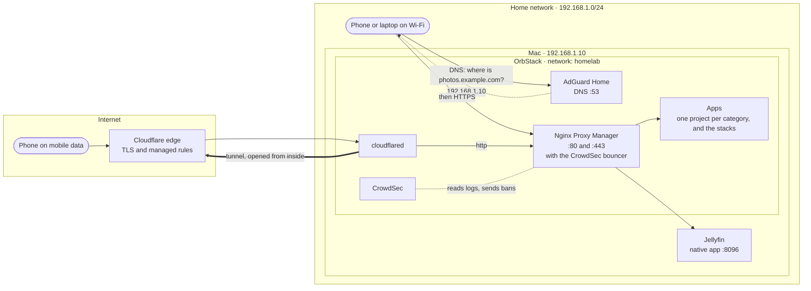
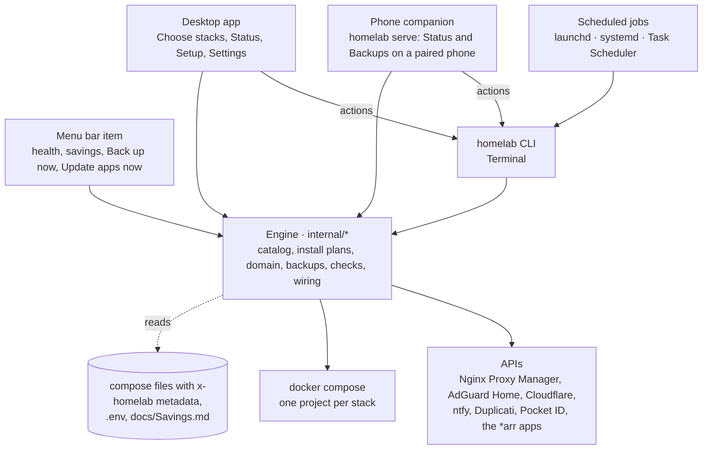

# Architecture

One Mac runs everything: containers in OrbStack, plus two native apps (Jellyfin, and the phone companion that `homelab serve` runs). Apps are split into Compose projects that share one Docker network.

Every new homelab starts in Home mode (`HOMELAB_DOMAIN` empty): Tailscale gives each app an https address on the tailnet, and nothing needs a domain, Cloudflare, or the proxy. With a domain, all traffic, from the LAN or from the internet, enters through Nginx Proxy Manager, where CrowdSec blocks known attackers. The topology below is that domain setup.

## Topology

Nothing listens on the router: the tunnel is opened from the Mac outwards, and every request, from home or from the internet, passes the same proxy and the same CrowdSec check before it reaches an app.

## Traffic paths

**Home mode:** device in the tailnet → `https://<TAILSCALE_HOST>:<port>` → Tailscale Serve in the `tailscale` container → app by service name. With `TAILNET_ADMIN_APPS=false`, the admin apps are left out and open on this machine only.

**LAN:** device → AdGuard Home (`*.example.com` → 192.168.1.10) → Nginx Proxy Manager (TLS, CrowdSec check) → app by service name on the `homelab` network.

**Internet:** visitor → Cloudflare edge (TLS, managed rules) → Cloudflare Tunnel → `http://nginx-proxy-manager:80` → CrowdSec check, using the visitor's address from `CF-Connecting-IP` → app.

**Native apps:** Nginx Proxy Manager → `host.docker.internal:8096` → Jellyfin on the Mac.

Only apps marked `public: true` get a public hostname in the tunnel. Every other hostname exists only in AdGuard, so it never resolves outside the home network.

## Compose projects

| Project | File | What |
|---|---|---|
| `homelab_network` | `compose/network.yaml` | Nginx Proxy Manager, AdGuard Home, Tailscale, ad blocking on the tailnet (`tailnet-dns`), Speedtest Tracker |
| `homelab_security` | `compose/security.yaml` | CrowdSec, Vaultwarden, Uptime Kuma, ntfy, Pocket ID |
| `homelab_system` | `compose/system.yaml` | Watchtower, Duplicati, Dozzle, Homepage, Homarr, the Docker socket proxy |
| `homelab_cloud` | `compose/cloud.yaml` | Syncthing, File Browser, Baikal, PairDrop, PsiTransfer |
| `homelab_documents` | `compose/documents.yaml` | FreshRSS, Stirling PDF, Open WebUI, Changedetection.io, Memos |
| `homelab_finance` | `compose/finance.yaml` | Wallos |
| `homelab_media` | `compose/media.yaml` | Navidrome, Feishin, Audiobookshelf, Calibre-Web, Komga, Kavita |
| `homelab_media_automation` | `compose/media-automation.yaml` | Prowlarr, the *arr apps, Seerr, LazyLibrarian, FlareSolverr, qBittorrent with Gluetun |
| `homelab_household` | `compose/household.yaml` | Home Assistant, Grocy, Mealie, Vikunja, Homebox |
| `homelab_cloudflare` | `stacks/cloudflare/compose.yaml` | cloudflared |
| `homelab_immich` | `stacks/immich/compose.yaml` | Immich server, machine learning, Redis, Postgres |
| `homelab_paperless` | `stacks/paperless/compose.yaml` | Paperless-ngx, Postgres, Valkey |
| `homelab_budget_tracker` | `stacks/budget-tracker/compose.yaml` | MoneyMatter frontend, backend, Postgres, Redis, exchange rates |
| `homelab_karakeep` | `stacks/karakeep/compose.yaml` | Karakeep, its headless Chrome, and Meilisearch (optional) |
| `homelab_romm` | `stacks/romm/compose.yaml` | RomM and its PostgreSQL (optional) |
| `homelab_ghostfolio` | `stacks/ghostfolio/compose.yaml` | Ghostfolio, PostgreSQL, Valkey (optional) |
| `homelab_docmost` | `stacks/docmost/compose.yaml` | Docmost, PostgreSQL, Valkey (optional) |
| `homelab_dawarich` | `stacks/dawarich/compose.yaml` | Dawarich, its Sidekiq worker, PostGIS, Valkey (optional) |

Single-container apps are grouped by category, one project each (`compose.yaml` holds the categories, presets, and native apps). Multi-container apps get their own project so they can be stopped, updated, or restored without touching the rest. Inside a stack, databases stay on the stack's private network; only the web-facing service joins `homelab`.

## One engine, three ways in

The desktop app and the phone companion read through the engine directly (catalog, status, plans, installs) and run the CLI for actions, so a button and a Terminal command always do the same thing. The phone answers only on the home network and the tailnet, and only to phones paired with a one-time code. The compose files are the single source: the CLI, the app, the generated docs, and the savings figures all read their `x-homelab` blocks. Scripts read the CLI's `--json` output, one `{"schema": 1, "type": ..., "data": ...}` object per line; `internal/api/testdata/contract.json` holds the fields a test keeps stable ([Commands](<Commands.md#driving-the-cli-from-an-app>)).

The desktop app updates itself (`internal/selfupdate`): Setup › **Update** moves the homelab files forward (`homelab upgrade`), then downloads the newest app build from the rolling `nightly` GitHub pre-release (the newest `v*` release with `UPDATE_CHANNEL=stable`), checks its SHA-256 checksum, and replaces the running app.

## A night in the homelab

| When | What | Notes |
|---|---|---|
| Every 15 minutes | Watchdog | Checks OrbStack, the proxy, the tunnel, every app's health, the database dumps' age, Duplicati's jobs, and the public names; alerts on the second failure in a row and pings the outside heartbeat |
| 01:00 | Duplicati: Photos | Immich's library, encrypted, into Proton Drive |
| 03:30 | `homelab backup` | Dumps every database (consistent SQLite copies too), archives listed volumes, copies `.env`; so every database has a dump from just before the updates. It also measures photos per person and each app folder (`data/storage.json`), asks GitHub once a day for homelab updates, and on Sundays sends the weekly summary |
| 04:00 | Watchtower | Pulls new images for opted-in apps and recreates them; reports to ntfy. The watchdog then keeps each app's previous image for a week and rolls back an app that stays unwell |
| 05:00 | Duplicati: Databases, Secrets | The fresh dumps and `.env`, encrypted, into Proton Drive |
| 05:30 | Duplicati: AppData, Stack Data | Every app's settings folders |
| Weekly | Duplicati: Infrastructure, Jellyfin, Calibre | The stacks folder and the larger libraries |

Details: [Automation](<Automation.md>) and [Backups](<Backups.md>).

## Baseline and slot-in apps

- **Baseline:** everything without a profile. `./homelab up` starts it, and the startup job runs it after every login.
- **Optional:** services with `profiles: [optional]` are defined and documented but stay off until `./homelab install <app>`.
- **New services:** add a block to the category's file in `compose/` (or a folder under `stacks/` for an app with its own database) with an `x-homelab` block. The CLI then installs, proxies, publishes, documents, and monitors it like the rest. See [Contributing](<Contributing.md>).

## Security boundaries

| Layer | Control |
|---|---|
| No open router ports | Cloudflare Tunnel and Tailscale connect outward |
| Tailnet (Home mode) | Only devices signed in to your tailnet reach the apps; `TAILNET_ADMIN_APPS=false` keeps the admin apps on this machine only |
| Edge | Cloudflare's free managed ruleset |
| Ingress (LAN and tunnel) | Nginx Proxy Manager with the CrowdSec bouncer |
| Detection | CrowdSec reads every proxy log and pulls the community blocklist |
| App ports | Bound to 127.0.0.1 on the Mac; other devices go through the proxy |
| Accounts | 40-character passwords in Vaultwarden, 2FA where offered |
| Secrets | `.env` (mode 0600) and Vaultwarden |

See [Security](<Security.md>) for details and [Decisions](<Decisions.md>) for why.

## Known architectural limits

| Limit | Effect |
|---|---|
| Single host | If the Mac is off or asleep, everything is down. `homelab move out` and `move in` carry it to a new machine. The awake job keeps it from sleeping while plugged in (`KEEP_AWAKE`). |
| FileVault | After a restart nothing runs until someone logs in (OrbStack and the jobs run in the login session). |
| A router that cannot push DNS | Each device's DNS is set to 192.168.1.10 by hand, or Tailscale's DNS setting points every Tailscale device at AdGuard (`@adblock`). |
| No VLANs | Everything shares the home LAN. |
