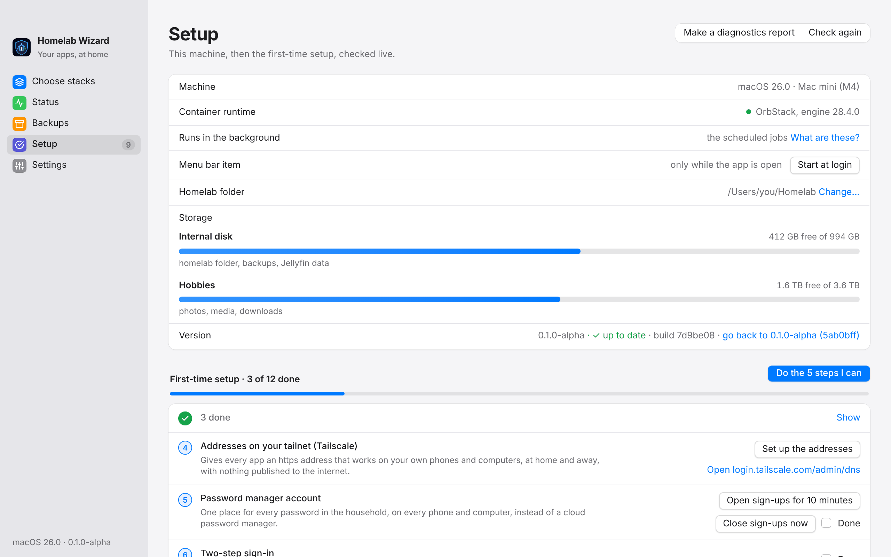
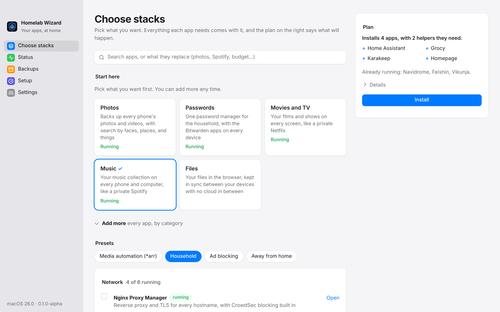
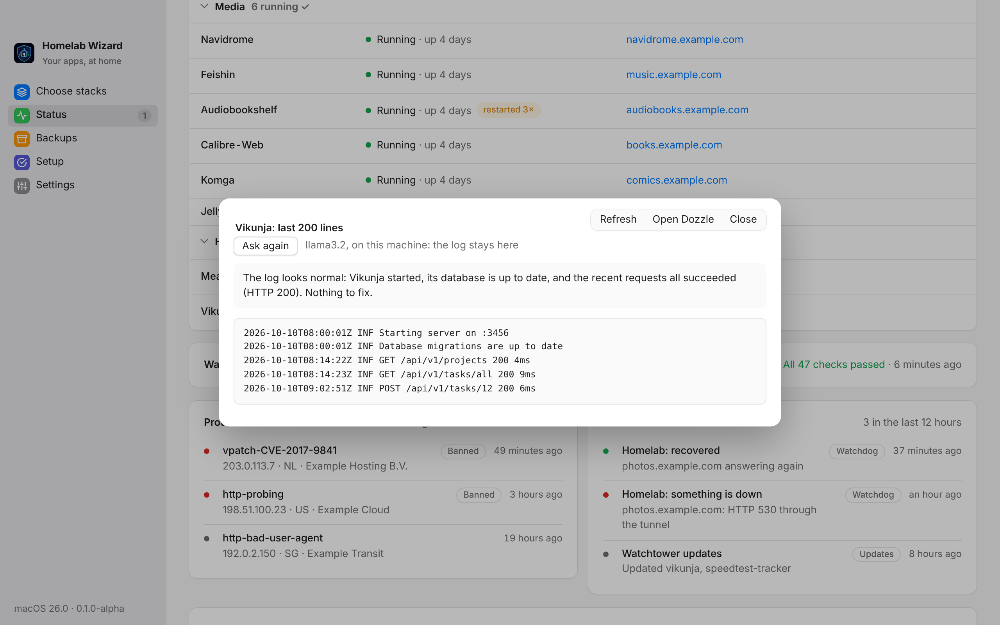

# Getting Started

From an empty Mac to a homelab the whole household uses, without reading any code. Set aside an afternoon; most of it is waiting for downloads.

> [!TIP]
> The desktop app's **Setup** screen walks through the same steps with a live check for each one, and does the technical ones for you. This page explains what each step is for and what to have ready.

## What you need

| | Why | Cost |
|---|---|---|
| A Mac with Apple Silicon that stays on | Every app runs on it. A Mac mini or a MacBook kept plugged in both work. | Already owned |
| A free Tailscale account | Gives every app a private `https://` address that opens on your own phones and computers, at home and away. Nothing is published to the internet. | Free |
| A cloud folder for backups | Encrypted copies of everything leave the house every night. Proton Drive is what this homelab uses. | An existing plan |
| An external drive (optional) | Movies, music, books, and photos that do not fit on the Mac. | Already owned |
| The router's admin page or app | To give the Mac an address that never changes. | |
| A domain on Cloudflare (optional, later) | Short addresses such as `photos.example.com`, and photos, passwords, documents, and music open away from home without Tailscale. See [Later: a domain of your own](#later-a-domain-of-your-own). | About $11 a year |

## 1. Install the basics

1. Install OrbStack, the engine the apps run in. Homelab Wizard's Setup screen offers **Download OrbStack** if you would rather skip Terminal; with [Homebrew](https://brew.sh):

   ```sh
   brew install --cask orbstack
   ```

   Open OrbStack once and turn on **Start at login** in its settings. Also `brew install smartmontools`: it lets the homelab read each drive's health and warn before one fails.

2. Install **Homelab Wizard**. In Terminal, paste:

   ```zsh
   curl -fsSL https://raw.githubusercontent.com/Snooper42/homelab-wizard/main/install.sh | sh
   ```

   It downloads the newest build from GitHub's Releases › **Latest**, checks it against GitHub's SHA-256 checksum, copies it to Applications, and opens it. The app is not signed with an Apple Developer ID, so macOS blocks it when it comes from a browser; fetched from Terminal, it opens like any other app. To use the browser instead: download `Homelab-Wizard-macOS.dmg`, drag the app from it to Applications, and clear the download flag once:

   ```zsh
   xattr -dr com.apple.quarantine "/Applications/Homelab Wizard.app"
   ```

   (Or open it, then System Settings › Privacy & Security › **Open Anyway**.) You only install it once: after that, Setup › **Update** keeps the app current by itself.

3. Open Homelab Wizard. On a new Mac it offers **Set it up for me**: it makes `~/Homelab` from the homelab files it carries, with no git or Terminal needed. Setup › **Update** later brings both the homelab files and the app up to date, keeping your settings, data, and own apps, and saving a copy of any file you changed as `.local`.

   To work on the homelab itself instead, clone it (the first time, macOS offers to install its command line tools; accept), and `brew install go` for the `./homelab` commands:

   ```sh
   git clone git@github.com:Snooper42/homelab-wizard.git ~/Homelab
   ```

Either way, Homelab Wizard finds `~/Homelab` on its own and opens on **Setup**. Every new homelab starts in **Home mode**: no domain, and every app at an address on your tailnet.

> **On Windows, Linux, or a Steam Machine** the steps are the same with that platform's pieces ([Host](<Host.md#linux-and-windows-hosts>) has the details):
>
> | | Windows 10 or 11 | Ubuntu, Debian, Fedora, Arch | Steam Machine (SteamOS, desktop mode) |
> |---|---|---|---|
> | The engine | Docker Desktop with WSL 2 (`winget install Docker.DockerDesktop`), started at sign-in | Docker Engine and its compose plugin; your user in the `docker` group | Docker Engine (SteamOS keeps its system read-only, so this part is still being tried: ISSUE-0012) |
> | The files | **Set it up for me** in the app, or `git clone` into your user folder, outside OneDrive | **Set it up for me**, or `git clone` into `~/Homelab` | **Set it up for me**, or `git clone` into `~/Homelab` |
> | The app | In PowerShell: `irm https://raw.githubusercontent.com/Snooper42/homelab-wizard/main/install.ps1 \| iex`, or GitHub › Releases › **Latest** › `Homelab-Wizard-Windows-Setup.exe` | `curl -fsSL https://raw.githubusercontent.com/Snooper42/homelab-wizard/main/install.sh \| sh`, or Releases › Latest › the `.deb`, `.rpm`, or Arch package | The same `install.sh` line (it puts the AppImage in `~/Applications`), or Releases › Latest › the AppImage: `chmod +x`, open it, then Setup › **Add to the app menu** (right-click it there › Add to Steam to open it in Game Mode) |
> | Terminal commands | `homelab.cmd` instead of `./homelab` | `./homelab` | `./homelab` |
>
> Each app build carries the `homelab` CLI and the homelab files, so Setup's buttons work without Go or git. Setup › **Update** brings the homelab files up to date and replaces the app with its newest build, as on a Mac. Setup's machine card can start the tray icon at login, and the AppImage can add itself to the app menu; both follow it if you move it or swap in a newer one.

<picture>
  <source media="(prefers-color-scheme: dark)" srcset="images/app-setup-dark.png">
  
</picture>

## 2. Work down the Setup screen

Each step says first what it gives you, then what to do. It turns into a green tick when its check passes, and **Check again** re-runs every check. **Do the steps I can** runs every step that is ready, one after another, and stops at the first that fails or when what is left needs you: a setting, a choice, or something only a person can do.

| Step | What it gives you | What you do |
|---|---|---|
| **OrbStack is running** | The engine for every app. | Nothing, once OrbStack is open. |
| **The homelab is started** | The homelab's own apps running (updates, backups, alerts), and a settings file with a strong, unique password for each one. | Click **Start the homelab**. The first start downloads every app and takes a while. |
| **This machine keeps its address** | Your phones always find the apps. | In the router's app, reserve the Mac's current address (the step shows it), then tick **Done**. |
| **Addresses on your tailnet (Tailscale)** | An `https://` address for every app that opens on your own phones and computers, at home and away, with nothing published to the internet. | Click **Set up the addresses** and sign in to Tailscale in the browser window it opens (make a free account there if you have none). In the Tailscale admin console › DNS, turn on **HTTPS Certificates**. No auth key is needed. |
| **Password manager account** | Vaultwarden, used through the Bitwarden apps, for everyone's passwords. Shown once Passwords is installed. | Click **Open sign-ups for 10 minutes**, create an account for each person at the passwords address, and let the window close. |
| **Two-step sign-in** | A stolen password alone opens neither the vault nor the homelab's settings. | In each Vaultwarden account turn on two-step login with an authenticator app (keep the recovery code with the recovery kit). In Nginx Proxy Manager add a personal administrator and turn on Two-Factor Auth for it, then tick **Done**. The homelab's own proxy account (`NPM_API_EMAIL`) keeps it off, because the homelab signs in with it. |
| **Backups leave this machine** | Somewhere safe for the nightly encrypted backups: a cloud drive survives fire and theft, an external drive restores faster. | Click the button for where they should go: **Use Proton Drive**, **Use iCloud Drive** (or Google Drive, OneDrive, Dropbox, whichever syncs on this Mac), or **Use the … drive** for an external drive. Each makes a *Homelab Backups* folder there. Any other folder: **Settings** › `BACKUP_DESTINATION` › **Choose…**. |
| **Backup jobs in Duplicati** | Settings, databases, and photos encrypted into the backup folder every night, so a dead disk loses nothing. | Click **Create the backup jobs**. Then, in **Settings**, **Copy** `DUPLICATI_SECRETS_PASSPHRASE` into Vaultwarden and write it on paper: it is the one key to every backup. |
| **Alerts on the phone** | A message on the phone when an app, a backup, or the connection fails. | Click **Set up the alert token**. In the ntfy app on your phone, add the ntfy address with user `phone` and the password from **Settings** › `NTFY_PHONE_PASSWORD` › **Copy**, then subscribe to the alert topics. |
| **Scheduled jobs** | The homelab starts again after a restart, backs up at night, and checks itself every 15 minutes. | Click **Install the jobs**. |
| **Alerts when this machine is down** | An email when the Mac itself stops, which the homelab cannot report on its own. | Create a free check at healthchecks.io (15-minute period and grace) and put its ping address in **Settings**. |
| **Tailscale on phones and computers** | The apps open on each device, at home and away. | Install the Tailscale app on each phone and computer, sign in with the same account, then tick **Done**. |
| **Ad blocking on every device** | Ads and trackers blocked on every device signed in to Tailscale, with no router change. Shown once *Ad blocking* is installed from Choose stacks. | Click **Set up ad blocking**, then in the Tailscale admin console › DNS add the address it shows as a custom nameserver and turn on **Override DNS servers**. |

If a step does not turn green, click **Make a diagnostics report** at the top of Setup. It writes one file with every check and log, with all passwords and tokens removed, that you can share when asking for help.

### Later: a domain of your own

Home mode needs no domain. When you want short addresses such as `photos.example.com`, or want some apps (photos, passwords, documents, music) to open on a phone without Tailscale, put your domain in **Settings** › `HOMELAB_DOMAIN` and Save. Setup then swaps the tailnet step for these:

| Step | What it gives you | What you do |
|---|---|---|
| **Home DNS answers (AdGuard Home)** | The home network learns the apps' names, and ads are blocked for every device that uses it. | Click **Set up AdGuard**: it answers AdGuard's first-run wizard with a new login. |
| **Cloudflare API token** | Lets the homelab get the padlock certificate and publish addresses. | Create a token with the three permissions the step lists, and paste it in **Settings**. Never paste it anywhere else. |
| **Addresses and certificate** | `https://` addresses for every app, on the Mac and on phones at home. | Click **Set up the domain**. The first certificate takes a few minutes. Apps you install afterwards get their addresses by themselves. |
| **This Mac finds its apps by name** | The addresses open on this Mac too, also with a VPN on, and for apps added later. | Click **Find the apps on this Mac** and enter the Mac's password once. |
| **Access away from home (Cloudflare Tunnel)** | Photos, passwords, documents, and music work on mobile data, with no ports opened on the router. | Create a tunnel in Cloudflare Zero Trust, paste its token in **Settings**, and click **Start the tunnel**. |
| **Phones and computers use the home DNS** | The app names work on every device at home. | On each device, set the Wi-Fi DNS server to the Mac's address, then tick **Done**. |

## 3. Choose more apps

Open **Choose stacks**. **Start here** has the five things most homes want first: Photos, Passwords, Movies and TV, Music, and Files. Click the ones you want. Every other app is under **Add more**, where each app says what it does and which subscription it can replace. Tick what you want, or pick a preset such as *Household* (smart home, groceries, to-dos, saved links, and a start page) or *Media automation* (the *arr apps, Seerr for requests, and qBittorrent behind a VPN). The plan on the right says in one line how many apps it installs and lists the ones you picked; helpers, port moves, and settings written wait under **Details**. When an app needs a setting first (the VPN key for qBittorrent, for example), the plan names it and the field to fill in appears below, with where to find it. Then click **Install**.

<picture>
  <source media="(prefers-color-scheme: dark)" srcset="images/app-choose-dark.png">
  
</picture>

## 4. Set up each person's phone

In Home mode, first install the **Tailscale** app on the phone and sign in with the same account as the Mac: the apps' addresses open only on devices in your tailnet.

| Install | To | Sign in at |
|---|---|---|
| Tailscale | Reach the apps at home and away (Home mode) | your Tailscale account |
| Bitwarden | Use the shared password manager | the passwords address, with the account from step 2 |
| Immich | Back up photos and browse them by face, place, or thing | the photos address |
| ntfy | Get the homelab's alerts (the person who looks after it) | the ntfy address, as user `phone` |
| Jellyfin or Infuse | Watch the movies and shows you own | the Jellyfin address |
| Any Subsonic music app, or Feishin in a browser | Listen to your music | the music address |

To open an app on a phone without typing its address, use the phone button on its row in **Status**: it shows the address as a QR code for the phone's camera, with what the phone needs (home Wi-Fi or Tailscale) and the app's phone app. Everything else opens in a web browser. Install **Homepage** from Choose stacks for one start page with every app on it, kept up to date by the homelab; the [Inventory](<Inventory.md>) lists every address too.

Each person can have their own sign-in. In **Settings** › **People**, click **Add a person**, give their name, email, and the apps they use, and click **Add them**: the homelab makes their account and opens a welcome page to print or send, with a one-time link to set up a passkey (Face ID or Touch ID), the apps they use, and their own tab on the start page. **New sign-in link** makes a fresh link, and **Remove** turns their sign-in off and keeps their data. People use **Pocket ID**; without it, the card offers **Install Pocket ID** first. With a domain, `./homelab sso setup` then lets Karakeep, Paperless-ngx, Mealie, Vikunja, and Open WebUI sign in with it.

For the person who looks after the homelab: Settings › **Phones** › **Pair a phone** shows a QR code. Scanned on the phone, it opens Status and Backups in the phone's browser (Share › Add to Home Screen keeps it as an app), at home or over Tailscale.

## 5. Day to day

- **Status** shows every app with a coloured dot. A category where everything runs folds into one line; what needs a look stays open at the top. Restart, update, stop, or read the log of any app from its row. The key button on the proxy, AdGuard, Duplicati, and PsiTransfer shows the sign-in the homelab made and copies the password. When something is down, **Fix it** shows a plan and puts it right. The menu bar icon shows the same at a glance.
- **This week** on Status is the Sunday summary at any time: apps, backups, the restore test, attacks caught, and disk space, with what needs a look marked. **What the apps keep** shows the largest app folders, and an app that was down part of the week says so (for example *96.2% up this week*).
- **Updates** to the apps install themselves at night. Pause them from Status or the menu bar before something important. If an update breaks an app, the rewind button on its row puts the previous version back (kept for a week), and an app that stays unwell after an update is put back by itself.
- **Updates to the homelab itself** show as **● Update ready** in the sidebar and the menu bar. Click it, then **Update** on Setup: it also downloads the newest Homelab Wizard, checks it, puts it in place, and opens it again (on Windows and Linux, after asking for an administrator's approval when it was installed with the installer or a package).
- **Backups** run at night. The **Backups** screen shows each app's newest copy and when a restore was last proven; once a month, click **Test a restore** to prove they work ([Backups](<Backups.md>)), and the homelab reminds you.
- **When something breaks**, an alert arrives on the phone. Open Status and click **Fix it**, or read the app's log and restart it; with Ollama on this computer, **Explain this log** says in plain words what it shows. If that does not help, make a diagnostics report.
- **Text too small?** Cmd and + or − (Ctrl on Windows and Linux) makes the whole app bigger or smaller, and Cmd and 0 goes back.

<picture>
  <source media="(prefers-color-scheme: dark)" srcset="images/app-logs-dark.png">
  
</picture>

## Where to go next

- [Troubleshooting](<Troubleshooting.md>): symptoms and their usual fixes.
- [Testing](<Testing.md>): the checklist for trying a new build.
- [Runbooks](<Runbooks.md>): step-by-step procedures, such as making an app public or updating the proxy.
- [Disaster Recovery](<Disaster Recovery.md>): moving to a new machine (Backups › **Moving to a new machine**), rebuilding from the backups, and the printable recovery kit.
- [Upgrading](<Upgrading.md>): what each update asks of you.
- [Savings](<Savings.md>): what each app can replace, and what that is worth.
