# Redesign

What the screens are being rebuilt toward, on the computer and on the iPhone, agreed with the owner on Nov 23, 2026 from the mocks below. **Nothing here is built yet.** The pictures are mocks drawn from `app/preview/redesign` (`make redesign`) with the screenshots' example household, not the app. Each screen is rebuilt to match its picture, one screen at a time, and this page says what "matching" means.

## Why

Finances had fallen well behind [MoneyMatter's live demo](https://moneymatter.app), the owner's reference for how a money app should feel. Compared at the same window size, MoneyMatter's first screen showed five answers (balance trend, latest transactions, cash flow, where the money went, progress to retiring early). Ours showed controls: a stopped-app banner, a title and subtitle, four header buttons, two rows of tabs, the period bar, a row holding only "Arrange the Dashboard", and then two numbers. Transactions showed no transactions on its first screen.

The reasons, so they don't come back:

- **Nobody owned the whole screen.** Each pull request added one feature and was judged by a picture of that one feature, so every feature became another card further down.
- **Every card was built differently.** No shared shape, no comparison to the period before, so no figure said whether it was good or bad.
- **Browser controls.** Native dropdowns where a designed one belongs.
- **Sentences as labels.** "Now, as typed in today" where a product says "Checking now" and explains on hover.
- **The homelab leaked into the money,** and the money into the homelab: a stopped app's banner on Finances, and every bank balance in the sidebar of every screen.

The other screens had the same habits: Status trying to be everything, Backups a list of twelve identical rows, Settings opening on Cloudflare token fields, Tidy Up opening on its own settings.

## What the owner decided

- **Finances: separate, with shared bills.** Each person has their own Finances; a shared bill (the mortgage, power, internet) is typed once with its split, and each person's Finances counts their share. The split varies by bill: 50/50, a fixed amount, or one person pays it all.
- **All of it:** transactions, categories, budgets and reports, as well as the paycheck plan.
- **SimpleFIN, opt-in for everyone.** Off until that person turns it on with their own SimpleFIN setup code; one person's connection never sees another's banks. Without it: bank files dropped in a watched folder. This changes the "no bank connection" decision (`Decisions.md`), which is rewritten when SimpleFIN is built.
- **As close to MoneyMatter as possible,** inside our own Finances, which keeps the paycheck plan MoneyMatter doesn't have.
- **A partner's Finances are "just separate",** not locked from the owner (`Private Finances.md` stays for whoever wants it, not the default).
- **A partner without the iPhone app** (no paid Apple Developer account yet) uses the phone's page, built to the same design as the app.
- **Tidy Up stays on the computer.** No Tidy Up on the phone.
- **A logo for every payee, from a logo service, opt-in** (the owner's pick, Nov 23): as MoneyMatter does, below.

## The pattern

Every screen is built from the same few parts. A screen that matches its picture but breaks one of these doesn't match.

### Cards

- **One shape:** a title (with at most two small icon buttons on its right), one big figure, a small capitalised label under it, and on the right a green or red chip comparing it with the period before ("↗ +$331.86 vs last paycheck"). Cents smaller than dollars.
- **A grid,** three columns on the computer, one on the phone. The first screen holds four or five cards, never a row of buttons.
- **Rows inside a card** have a logo or icon on the left, a name with a short line under it, and the amount or the action on the right.
- **Every card opens what it summarises** (its ↗).
- **Nothing empty:** a card's height comes from what it holds; no tall card beside a short one leaving a hole.
- **Cards in a row are built the same way** (the owner, Nov 25: *"we need to stop doing that"*, of three cards on a row each laid out differently): the title row, then **one figure on the same line in every card**, then **one line under it**, then a **footer pinned to the bottom at the same height** (the buttons, the nights, a bar). **No boxes inside a card**, no text that wraps in a figure, no empty band under one card's content where its neighbour has more. If one card has more to say, it goes behind its ↗, not into the card.
- **Every card is drawn in every state it can be in** (the owner, Nov 25: *"what's gonna happen to that box … once we start it up again"*): all well, one problem, several, no data yet. A card never appears, disappears or changes size when the state changes; only what's inside it does. A card *about* a problem ("Stopped", "Decypharr") isn't a card: the card is the thing the problem belongs to (Apps), and the problem is its state.

### The computer's sidebar

- **Every screen's sidebar is laid out as Finances'** (the owner, Nov 24, changing the pictures' plain menu: "making sure both of these are the same"): the homelab's screens as a strip of icons at the top, then that screen's own menu (Finances: Dashboard, Transactions, Budgets, Bills & paychecks, Calendar, Shared with …, Net worth, Reports; Tidy Up: Overview and each library; Status: Overview and each category; Backups: Last night, Needs you, Restore test, Off-site, Each app; Choose apps: its categories; Setup: its steps), then its lists (accounts; drives), and Settings at the foot, with one line on the computer (free space, power).
- **The strip is the app's three places** (the owner, Nov 27: *"just Status or the apps page, Tidy Up, and then Finances … a box with dividers between the 3 sections. This is the bulk of my app"*): **Home** (Status renamed), **Library** (Tidy Up renamed, the owner, Nov 27; its button is still *Tidy up now*) and **Finances**, each with its name under its icon, in one rounded box with thin dividers, the one shown raised. ⌘1 to ⌘3 open them. **No badges** on the strip or the icon rail (*"I also don't want badge indicators"*): a screen says what's wrong on itself, and the line over the other screens' titles names a stopped app (it says nothing when all is well). **Setup** leaves the strip: it's the first entry in Settings' list while steps are left (*8 left*, in grey), and Home shows **Finish setting up** under its three cards.
- **Bank accounts appear only in Finances.**
- Finances' sidebar ends with whose Finances these are, and when the banks were last read.

### The top bar

One row: the main action (Add transaction, Back up now, Tidy up now) and, in Finances, the period ("‹ Alex's paycheck, Nov 6 – 19 ›" with Paycheck or Month) and three icon buttons (hide amounts, read banks now, customise). No subtitle, no second row of tabs.

### The phone

- **Four tabs:** Status, Backups, Finances, Settings. Setup leaves the tab bar (unfinished steps show on Status). A partner's phone has three: Finances, Apps (her homelab apps, one tap each), Settings.
- **One problem, one badge.** A stopped app badges Status, not Status and Backups.
- **The same cards as the computer,** one column, the same figures and words.
- A detail page has a back button and its own title, and no search bar from the screen before.

### Words

Short labels, the explanation one tap or hover away; sentence case on both systems ("Open its page", not "Open Its Page"); one unit style (GB and MB, a space before the unit). The plain-words rules still hold: no code names, no jargon without its meaning.

### Colours and type

The app's own tokens (`--fin-accent`, `--fin-in`, `--fin-out`, the category hues in `hues.ts`), the near-black dark theme with cards a step lighter, the logos in `web/src/finances/logos.ts` and `apple-client/Shared/Assets.xcassets/AppLogos`. Every picture below has a dark twin (`-dark.png`).

## Each screen

Light pictures; the dark ones sit beside them in `images/redesign/`, and `-full` ones show the whole page scrolled.

### Finances on the computer

<picture>
  <source media="(prefers-color-scheme: dark)" srcset="images/redesign/computer-finances-dark.png">
  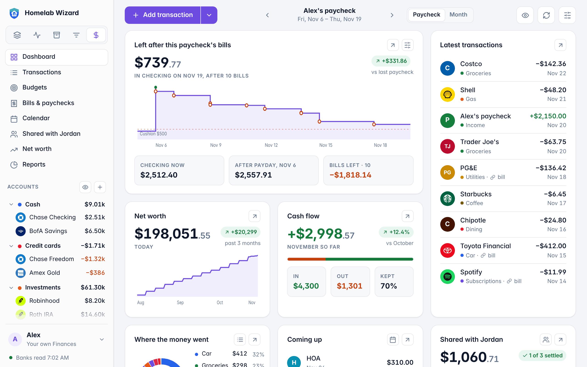
</picture>

Leads with **Left after this paycheck's bills**: the figure, a step chart of checking through the period (each bill a dot, the cushion a dashed line), and Checking now, After payday and Bills left under it. Then Latest transactions, Net worth, Cash flow, Where the money went, Coming up, Shared with …, Budgets and Investments ([the whole page](<images/redesign/computer-finances-full.png>)).

<picture>
  <source media="(prefers-color-scheme: dark)" srcset="images/redesign/computer-transactions-dark.png">
  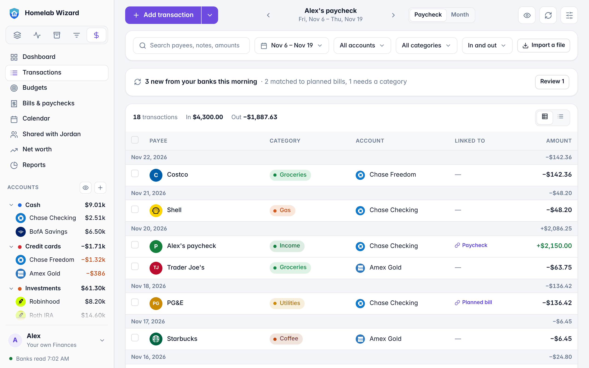
</picture>

**Transactions** starts with the table: filters in one row of designed dropdowns, a strip for what the banks brought in ("3 new … 1 needs a category", Review), then the rows grouped by day with each day's total, the payee's logo, the category's coloured tag, the account, and what planned bill or paycheck the row paid. Budgets and This month move to their own pages.

### Backups on the computer

<picture>
  <source media="(prefers-color-scheme: dark)" srcset="images/redesign/computer-backups-dark.png">
  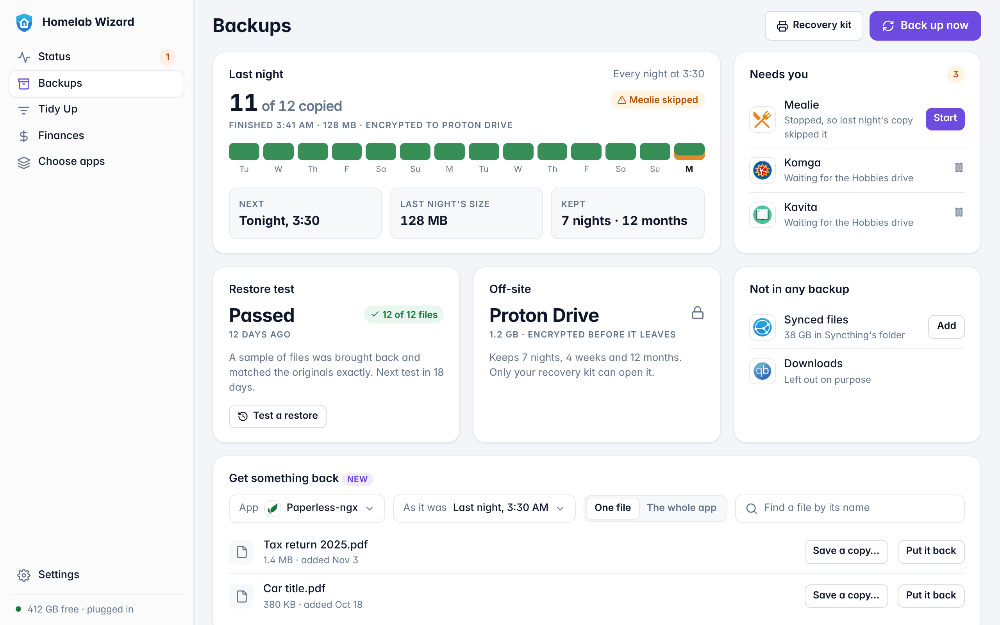
</picture>

Last night ("11 of 12 copied", what was skipped, fourteen nights as squares, the next run), Needs you (with Start), Restore test, Off-site, **Not in any backup**, **Get something back** (an app, a night, one file or the whole app), and each app compactly, with its last seven nights as dots ([the whole page](<images/redesign/computer-backups-full.png>)).

### Settings on the computer

<picture>
  <source media="(prefers-color-scheme: dark)" srcset="images/redesign/computer-settings-dark.png">
  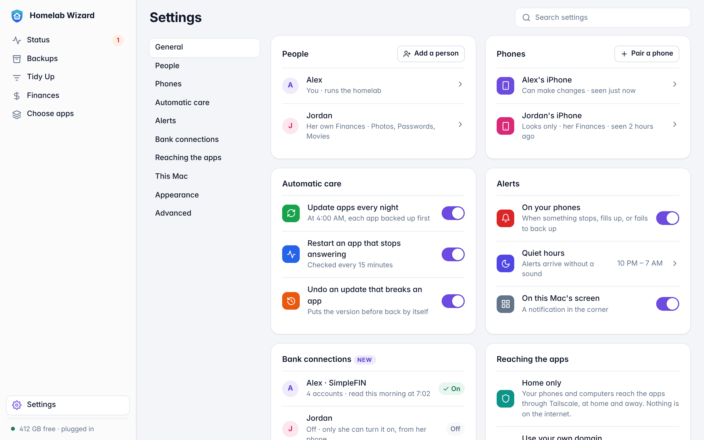
</picture>

Grouped by what a household does: People, Phones, Automatic care, Alerts and quiet hours, **Bank connections** (each person's SimpleFIN, on or off), Reaching the apps (home only, or your own domain), This Mac. Each app's own keys and tokens, today's first screen, move under **Advanced**.

### Tidy Up on the computer

<picture>
  <source media="(prefers-color-scheme: dark)" srcset="images/redesign/computer-tidy-dark.png">
  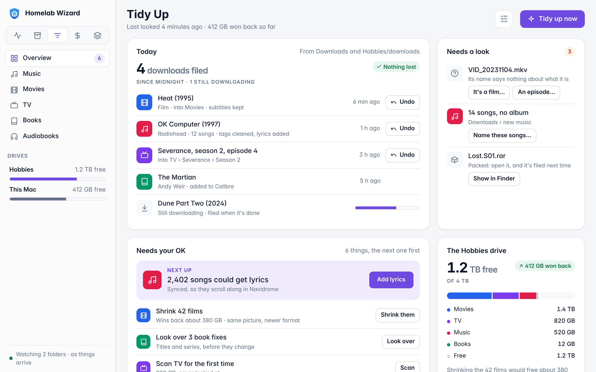
</picture>

Leads with what happened and what needs you: Today (each download filed, with Undo; one still downloading), Needs a look (the downloads it couldn't place, each with its button), Needs your OK (the next step first, largest; a step that throws things away never gets the main button), the drive, Your libraries, Recently done, Genres ([the whole page](<images/redesign/computer-tidy-full.png>)). Watched folders and when to tidy move behind the settings button. A library's own step-by-step clean-up moves into its page.

**Built as Status' Overview** (the owner, Nov 27, over the picture above: *"it needs to obviously mesh nicely into our app"*): three cards of Status' anatomy first, *Today* (how many downloads were filed, from which folders, the newest with Undo), *To tidy* (how many things, the space they'd win back, the first one's button: the screen's one main button) and the drive (what's free, one bar of what each library takes, largest first). Then Needs a look when something waits, What I did today only on a day something was filed, *Needs your OK* as one plain list with no main button of its own, the libraries as plain cards (colour on the icon and the bar only), and Genres beside Recently done.

### On the iPhone

<picture><source media="(prefers-color-scheme: dark)" srcset="images/redesign/phone-finances-dark.png">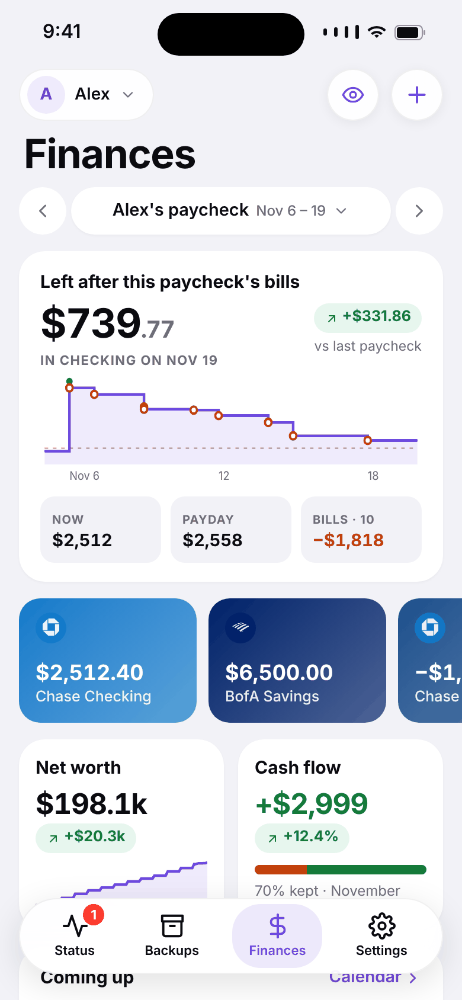</picture>
<picture><source media="(prefers-color-scheme: dark)" srcset="images/redesign/phone-transactions-dark.png">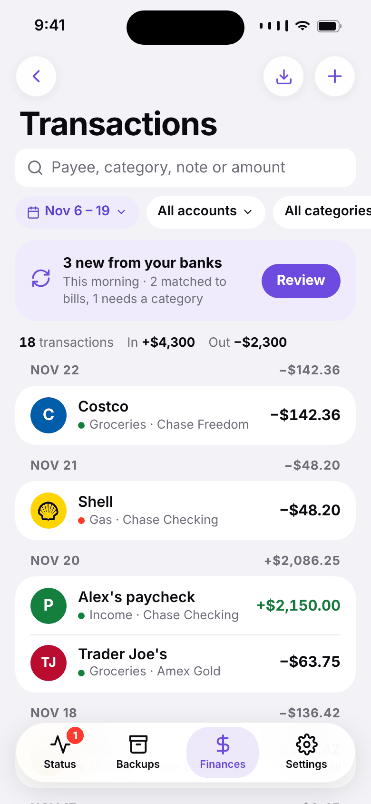</picture>
<picture><source media="(prefers-color-scheme: dark)" srcset="images/redesign/phone-status-dark.png">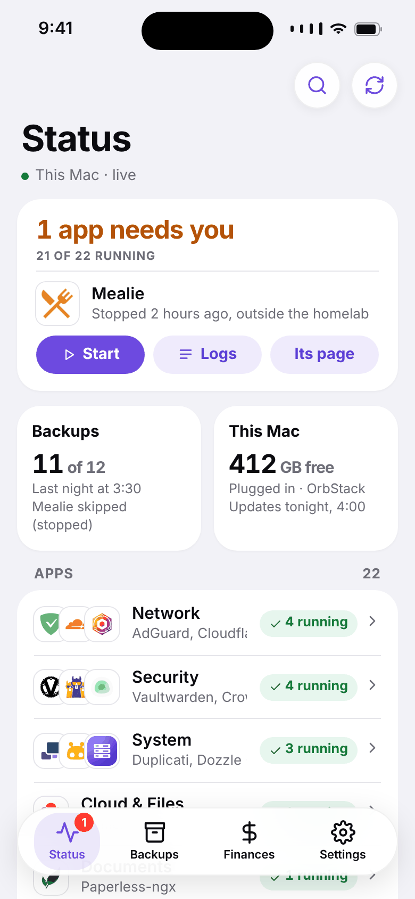</picture>

<picture><source media="(prefers-color-scheme: dark)" srcset="images/redesign/phone-partner-dark.png">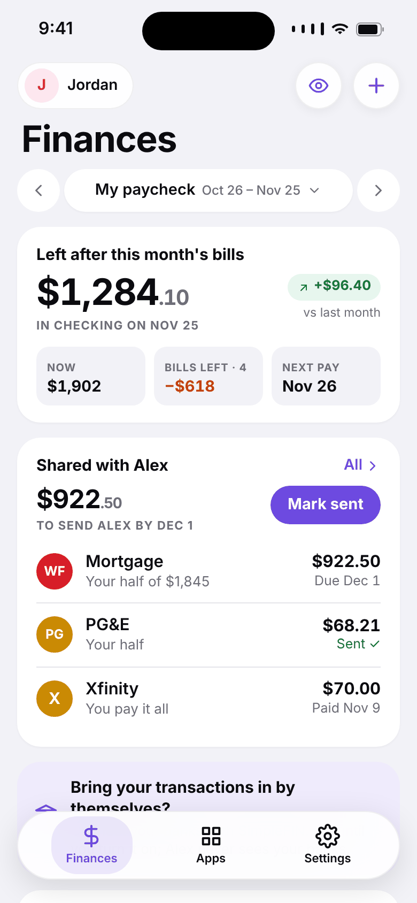</picture>
<picture><source media="(prefers-color-scheme: dark)" srcset="images/redesign/phone-backups-dark.png">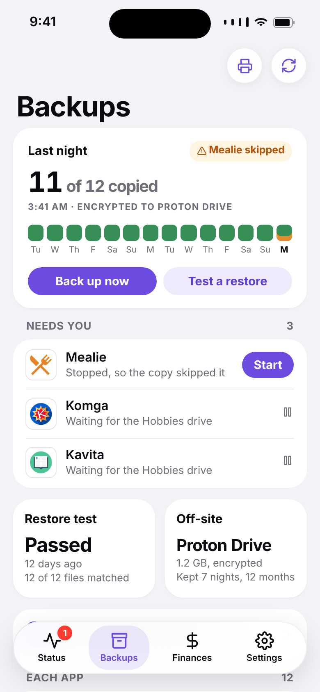</picture>
<picture><source media="(prefers-color-scheme: dark)" srcset="images/redesign/phone-settings-dark.png">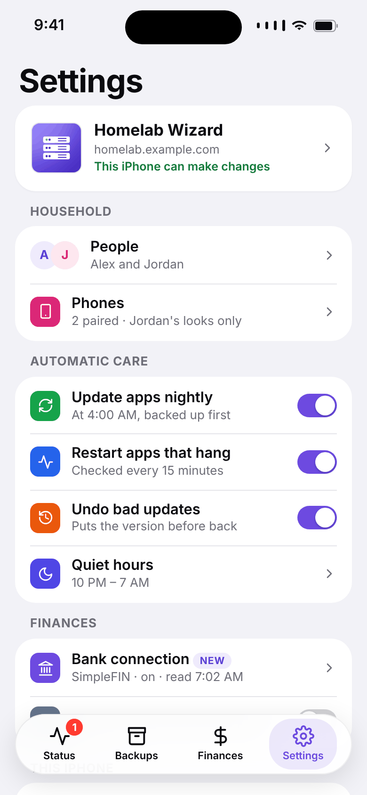</picture>

- **Finances:** whose Finances at the top left, the period as one pill, the same lead card, the accounts as small cards to swipe (in place of one card the width of the screen), then Net worth and Cash flow side by side, Coming up, Shared with …, Latest transactions, Budgets ([whole](<images/redesign/phone-finances-full.png>)).
- **Transactions:** no account card above them; search, filter chips, the banks' strip, rows by day ([whole](<images/redesign/phone-transactions-full.png>)).
- **Status:** "1 app needs you" with Start, Logs and Its page; Backups and This Mac; each category one row with a few names and "4 running" ([whole](<images/redesign/phone-status-full.png>)).
- **A partner's Finances:** her own paycheck, **Shared with …** from her side (what to send, Mark sent, what she pays herself), and SimpleFIN offered as hers to turn on ([whole](<images/redesign/phone-partner-full.png>)).
- **Backups** and **Settings:** the computer's, in one column ([Backups whole](<images/redesign/phone-backups-full.png>), [Settings whole](<images/redesign/phone-settings-full.png>)).

### The phone's page

How far the phone's page (`homelab serve`) can go toward the Homelab app, drawn on a server's homelab: tailnet only, with streaming apps added as its own (Nov 25, from a tester's server). It's the desktop app's own screens, so every screen above reaches it; these four show what it adds.

<picture><source media="(prefers-color-scheme: dark)" srcset="images/redesign/web-status-dark.png">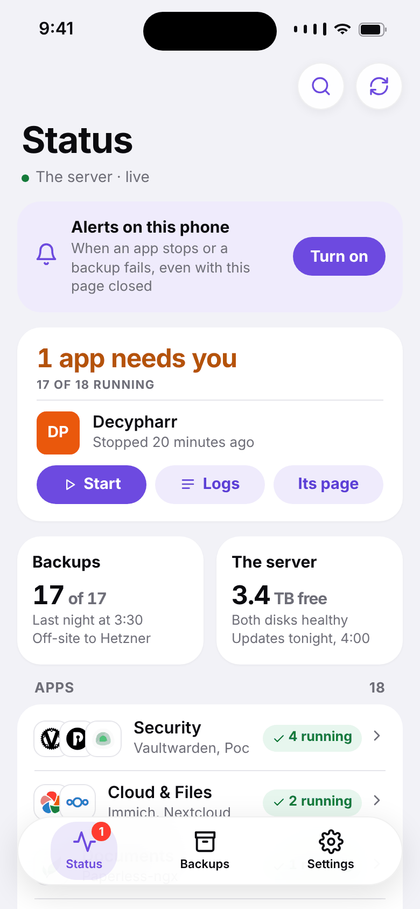</picture>
<picture><source media="(prefers-color-scheme: dark)" srcset="images/redesign/web-app-dark.png">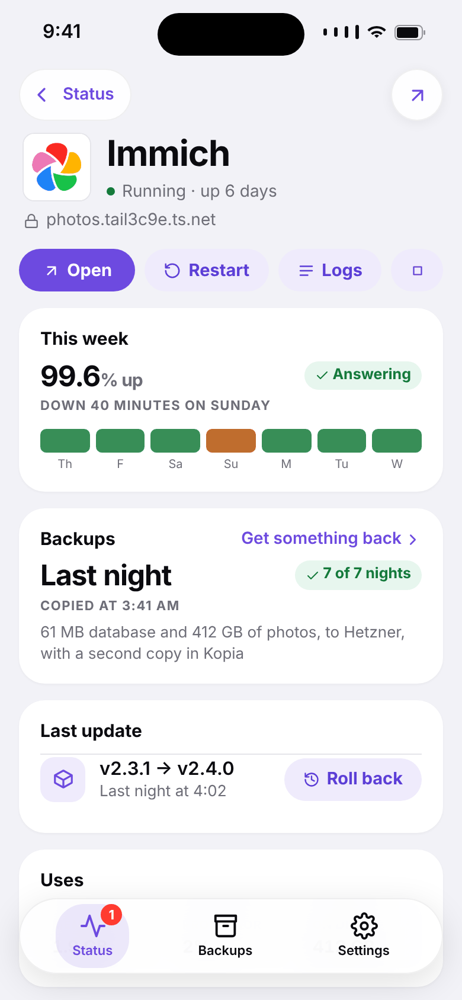</picture>
<picture><source media="(prefers-color-scheme: dark)" srcset="images/redesign/web-push-dark.png">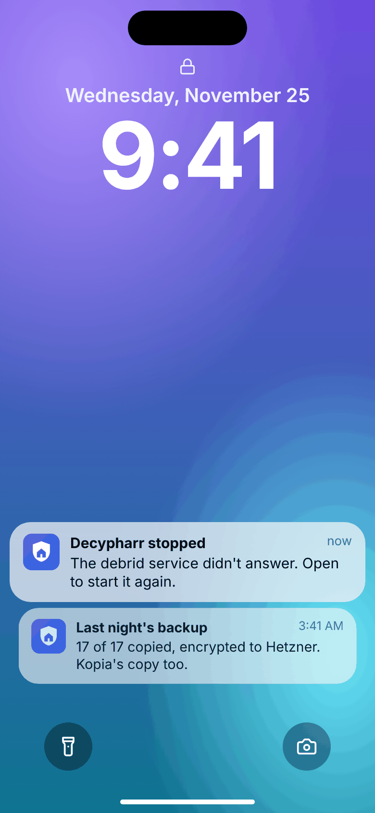</picture>

<picture><source media="(prefers-color-scheme: dark)" srcset="images/redesign/web-wide-dark.png">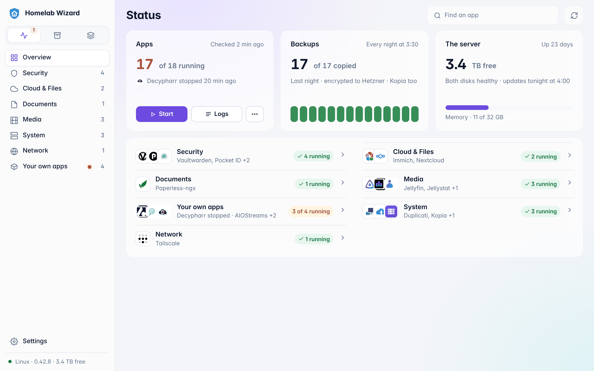</picture>

<picture><source media="(prefers-color-scheme: dark)" srcset="images/redesign/web-wide-ok-dark.png">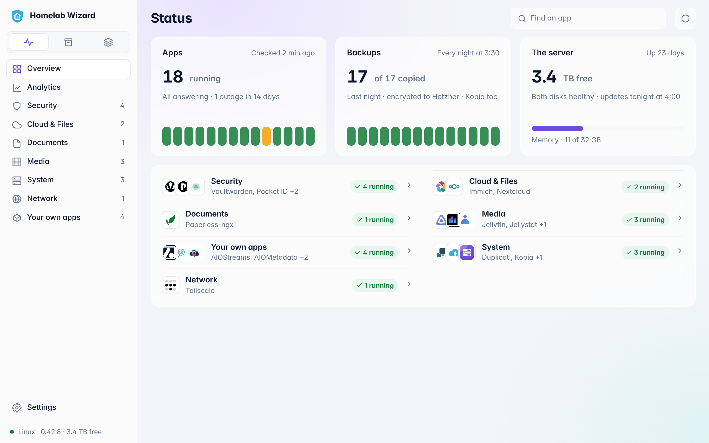</picture>

**Status' first card is Apps, always.** All well: how many run, *All answering · 1 outage in 14 days*, and the last fourteen days as squares (amber on a day any app was down), as Backups shows its nights. Something stopped: the figure turns amber (*17 of 18 running*), the line names it with its logo (*Decypharr stopped 20 min ago*), and the footer becomes **Start**, **Logs** and ⋯ (two or more: **Start all** and **See them**). Start it and the card goes back without moving.

- **Status:** the phone's Status above, with the server in place of This Mac, and **Alerts on this phone** offered once.
- **An app's page:** a back button and its own title; Open, Restart, Logs and Stop; its week, its backups (with Get something back), its last update with Roll back.
- **Alerts:** Web Push to the page added to the Home Screen (iOS 16.4 and later), from the alerts the computer already keeps, quiet hours kept. No Apple Developer account needed, unlike the app's push.
- **On a tablet or a wide window:** the computer's sidebar, the screens as a strip of icons then Status' own menu: **Overview, then each category, your own apps last** (a box, never a +, which read as *add an app* in the middle of the list). **No *Stopped* item** (the owner, Nov 25): a category holding a stopped app shows an amber dot by its count, and Status' badge on the strip still counts it; today the phone's page keeps the old list above 700 px (every strip rule is `html:not(.companion)`, and the screens mount no menu on the phone).

#### A category's page: the apps as a home screen

The owner, Nov 25: click a category in Status' menu (Network, Media, …) and get its apps as tiles, three across, with CasaOS's dashboard as the reference (its ideas only, never its look, words or pictures; its own screenshot is in its repository's README). After two passes the owner liked this one: **the icon is the hero**, the tiles are light and see-through over a soft backdrop, and the live numbers live in widgets rather than on every tile.

<picture><source media="(prefers-color-scheme: dark)" srcset="images/redesign/web-category-dark.png">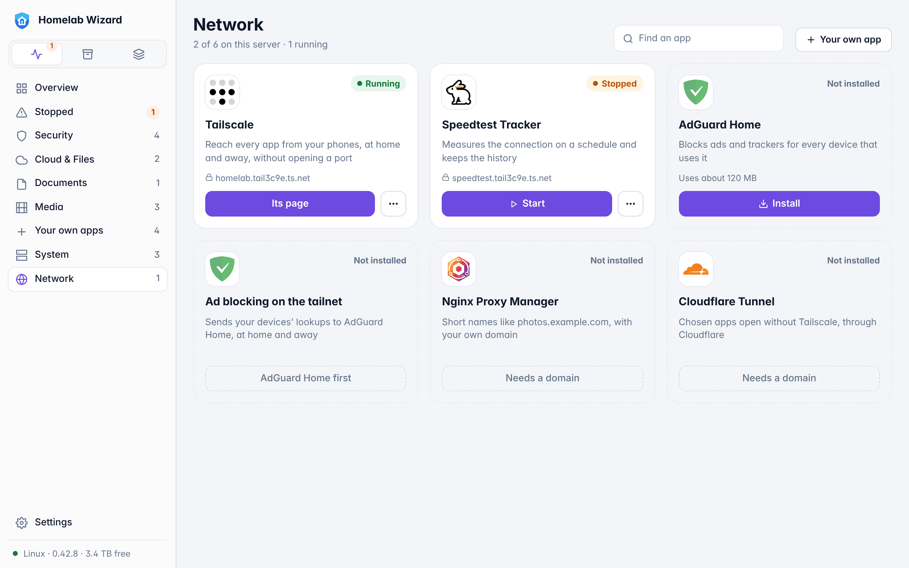</picture>

<picture><source media="(prefers-color-scheme: dark)" srcset="images/redesign/web-category-duo-dark.png">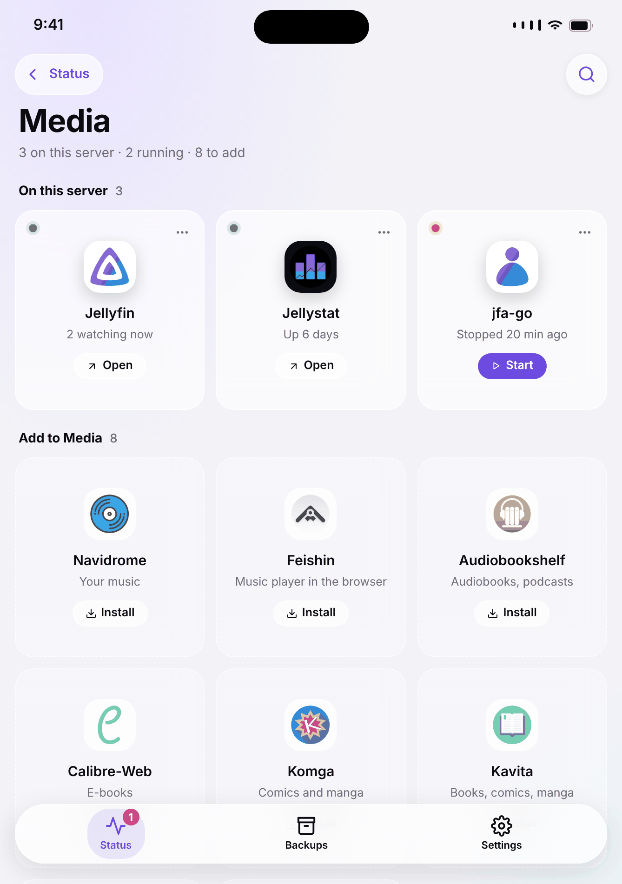</picture>
<picture><source media="(prefers-color-scheme: dark)" srcset="images/redesign/web-category-phone-dark.png">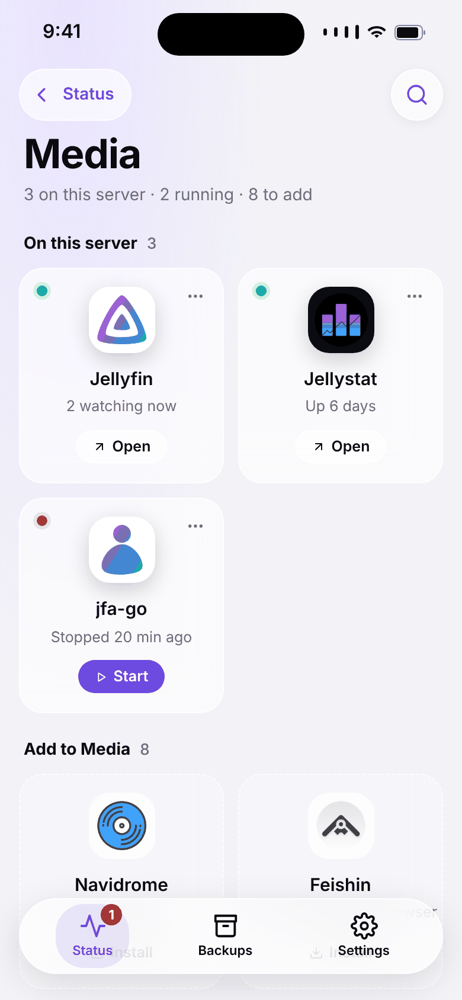</picture>

- **A tile:** the app's logo, big (64 px; 56 on a phone) and centred; its name; one short live line (*2 watching now*, *Up 6 days*, *Stopped 20 min ago*); one small button, **Open** (or **Start**, in the accent, when stopped); a status dot top left (green running, amber stopped); ⋯ top right for the rest (Its page, Restart, Stop, Logs, Remove). Nothing else on the tile.
- **No widgets on a category's page** (the owner, Nov 25: the machine's numbers *"need[s] its own dedicated analytics screen"*): only the title, *3 on this server · 2 running · 9 more to add*, and the apps. Processor, memory, drives and what each app uses live on **Analytics**, under Overview in Status' menu (its picture is being mocked on another account; lay it out from that, in this pattern).
- **On this server**, then **Add to <category>**: **every** app of that category not installed (the owner, Nov 25: no *More* tile, show them all), faded with a dashed edge, each with **Install**, in the catalog's order. A long category simply scrolls; Find an app narrows it.
- **The backdrop:** the page's own colour with two soft glows (violet top left, teal bottom right; lighter by day); tiles and widgets are translucent with a blur, a hairline edge, radius 20.
- **Every app has a logo** (owner, Nov 25: *"add logos everywhere"*): the catalog's, or for your own apps the app's own icon (below, and `web-loop.md` W17); letters only while none is found.
- **Three across** on a tablet, a wide window and the iPhone Duo unfolded; **two** on a phone.
- **Install** on the phone's page waits for the owner's yes for Choose apps on the phone (W13).

**On the computer too** (the owner, Nov 25: *"I want this incorporated into the computer app"*): Homelab Wizard's own window gets the same pages, with its full strip of screens and *On this Mac* ([the whole page](<images/redesign/computer-category-full-dark.png>)).

<picture><source media="(prefers-color-scheme: dark)" srcset="images/redesign/computer-category-dark.png">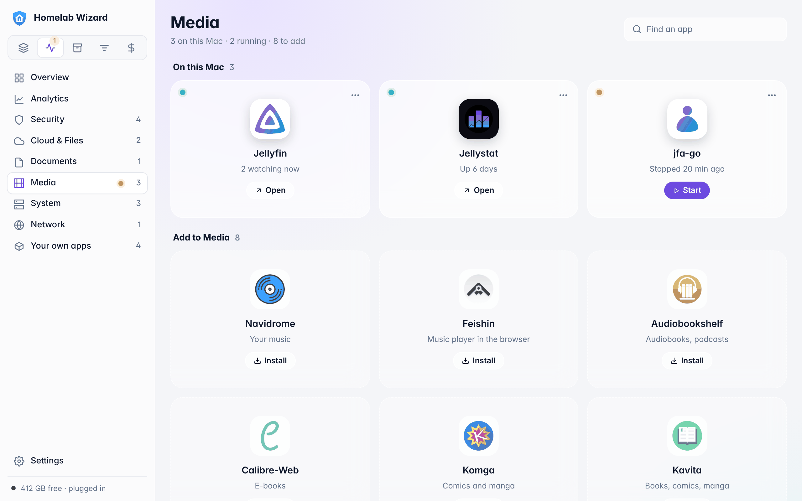</picture>

#### Analytics

The owner, Nov 25: the machine's numbers on a screen of their own, under Overview in Status' menu, not on every category ([the whole page](<images/redesign/web-analytics-full-dark.png>)).

<picture><source media="(prefers-color-scheme: dark)" srcset="images/redesign/web-analytics-dark.png">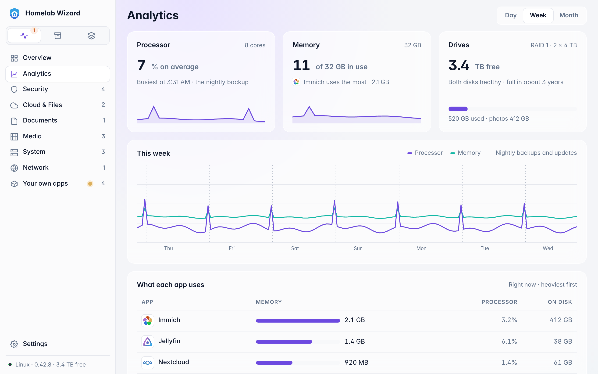</picture>

<picture><source media="(prefers-color-scheme: dark)" srcset="images/redesign/web-analytics-phone-dark.png">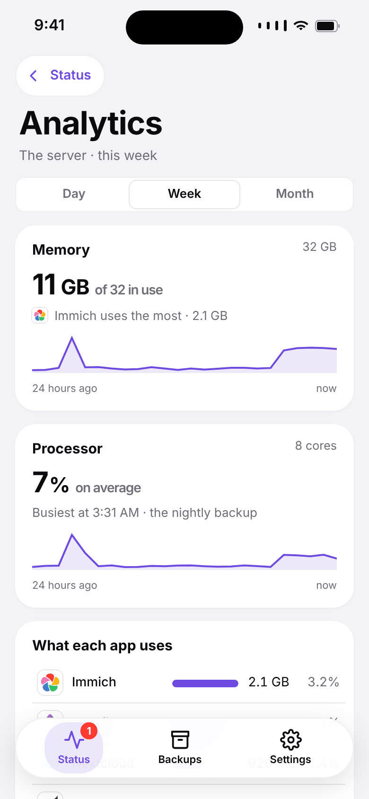</picture>

- **Day, Week, Month** on top, changing every part of the page.
- **Three cards built one way** (*Cards*, above): **Processor** (the average, when it was busiest and why: *the nightly backup*), **Memory** (in use of the total, the app that uses most with its logo), **Drives** (free space, health, *full in about 3 years* from the growth so far). Each footer is the last 24 hours as a line, scaled to its own range, or the drive's bar.
- **This week**, two charts on one timeline: processor in %, memory in GB (never two units on one axis), the scale in a gutter on the right, each night's backup and updates as a dotted line so a spike explains itself.
- **What each app uses**, heaviest first, the eight heaviest then **Show all**: its logo, memory now as a bar and a figure, **its week as a line** on a fair scale (half to one and a half times its usual, so a steady app reads flat and a growing one, like Immich as photos arrive, reads as growing), processor, and what it keeps on disk. A row opens the app's page. On a phone: memory and processor only.
- **Figures with their units as one piece** (*7%*, *11 GB*, *3.4 TB*), the detail small after them.
- Its data: `StatusBoard`'s `usage` and `storage`, the history the computer keeps (Beszel's where it runs, else the agent's own samples), and the jobs' times. Nothing new leaves the machine.

#### Toward 1.0: an app store

The owner, Nov 25: *"little by little once we reach 1.0 I could add more and more apps and this could become sort of like an App Store where anybody on any platform could just download this or access it via the web and then they could configure and add any apps they want."* So a category's *Add to …* half is the store's shelf, and every choice now should let it grow:

- **The catalog grows without a release of the app:** apps described as data (`compose/`, `x-homelab`), so an added app reaches every homelab with the homelab files' update, and *Add to …* shows it.
- **The same shelf everywhere:** the computer, the phone's page and the iPhone app all show a category's apps to add from the same catalog call; Install where the device may make changes.
- **An app's store page:** what it does, its pictures, what it needs (memory, a domain, another app), what it replaces, and Install; reached from a tile's ⋯ or by tapping a faded tile.
- **Anyone's app, safely:** your own apps (`homelab custom add`, the pasted compose file) stay the way to run something the catalog doesn't have; a shared catalog of other people's entries is a later decision (who reviews them, how they're signed), for the owner.

## Logos for every payee

Every row in the pictures has its payee's logo; in the app today most imported payees are a letter. How the others do it:

- **MoneyMatter** keeps a website for each payee and shows that website's logo from a logo service (`img.logo.dev/nike.com`, seen in its live demo), with a logo search to pick the brand when a payee has none, and its first letter while nothing has loaded.
- **Monarch Money** gets a cleaned merchant name, website and logo with each transaction from the bank-data companies it reads banks through (Plaid, MX and others), with its own merchant list on top.
- **SimpleFIN gives none of that:** only the bank's own text ("SQ *BLUE BOTTLE 0423 OAKLAND CA"). The logos are this app's job either way.

A logo takes three steps, and the app is good only at the last:

1. **The bank's text to a merchant** ("SQ *BLUE BOTTLE 0423 OAKLAND CA" to Blue Bottle Coffee): `cleanPayee` and `shopOf` in `payees.ts` (and their Swift port), extended to the card processors' prefixes and a merchant list's spellings.
2. **The merchant to its website** (bluebottlecoffee.com): today 337 brands and a guess of the name plus .com (`sites.ts`).
3. **The website to its logo:** today **Get the real logo** (`internal/sitelogo`), only when clicked.

What the owner picked:

- **Built in, always:** every brand in the simple-icons package (about 3,300, not 337), and a list of common merchants with how banks spell them and their websites. Nothing leaves the computer for these.
- **A logo service, off until turned on** (logo.dev, which MoneyMatter uses, or Brandfetch: picked when it's built). When on, a payee the app doesn't know is looked up by name for its website and logo, **once**, and the logo kept in the plan from then on. One plain line before it's on: the service sees which shops you use, never an amount. Its key is kept like the other secrets and asked for by the computer, never by a page or the phone, so the key stays home. Per person, like SimpleFIN: a partner's Finances use it only if she turns it on. The security session reviews the new host.
- **Fix one by hand:** a payee's website, and a logo search ("blue bottle", then pick), as MoneyMatter's.
- **Nothing found** (a person, an HOA, a loan): the category's icon or a monogram in the category's colour, never a grey letter.

**Done when** the owner's last month of transactions shows a real logo on at least nine rows in ten with the service on, and every other row its category's mark.

## New work behind the pictures

Most of the redesign is the same data laid out again. These pieces need something the app doesn't do yet, and each is its own item, not part of "the layout":

| Piece | Where it shows | What it needs |
|---|---|---|
| **SimpleFIN, per person** | Finances (banks read, Review), Settings › Bank connections, a partner's phone | Claiming a person's setup code, reading accounts, balances and transactions each morning and on Read now, through the import's path (duplicates, rules, planned bills); off by default; the new host reviewed for security; `Decisions.md` rewritten |
| **Balances from the bank** | Finances, Update balances | A balance from SimpleFIN or a bank file's balance line (OFX `LEDGERBAL`) sets the account; today an import never changes a balance |
| **The watched folder** | Transactions | Bank files dropped in a folder, imported and moved aside, for whoever doesn't use SimpleFIN |
| **Shared bills with splits** | Shared with … (both people's Finances), Coming up | A bill marked shared with its split (50/50, an amount, or one person), each person's share counted in their own plan, what's been paid; replacing `homelab person share`, today a terminal command |
| **Who's Finances, and a partner's own tabs** | Finances' sidebar foot, the phone | Switching between your Finances and the shared view; a partner's phone with Finances, Apps and Settings only |
| **Get something back** | Backups | One file or a whole app from a chosen night, through the backup engine, saved as a copy or put back |
| **Not in any backup** | Backups | Working out what's left out (Syncthing's folder today), and adding it |
| **Each app's last nights** | Backups | Each night's result per app kept, if it isn't already |
| **Comparison chips** | Every Finances card | The same figure for the period before |
| **Web Push** | The phone's page, Lock Screen | The computer's own VAPID keys, a subscription per paired phone kept with it, the kept alerts sent to Apple's and the browsers' push services as well as ntfy, quiet hours honoured; the new outgoing hosts reviewed for security |
| **The phone's page on a wide screen** | The phone's page on a tablet | The sidebar's strip and each screen's menu for `html.companion` above 700 px, sized to the screens a phone has; a phone in landscape keeps the tab bar |
| **Logos for every payee** | Every row with a payee, on both systems | All of simple-icons and a merchant list built in; the opt-in logo service (above); a payee's website and a logo search; the category's mark when nothing is found |

## Still to decide

- A partner's Finances as drawn: the owner shows it to her.
- Setup off the phone's tab bar, with its unfinished steps on Status.
- The phone's accounts as small cards to swipe, or a list.
- Choose apps, an app's page and Setup aren't mocked: they follow the pattern above.

## Redrawing the mocks

`make redesign` (or `node app/preview/redesign/build.mjs`) draws every mock from `app/preview/redesign/` into `docs/images/redesign/`, in light and dark, and leaves its pages in `app/preview/redesign/html/` to open in a browser. The accounts, bills, paychecks and net worth are the screenshots' example household (`app/preview/finance.json`); November's transactions, a partner's figures and Tidy Up's day are made up to fill the screens. Change a mock there, redraw it, and change this page with it: the pictures are the target the screens are built to.
