# A tour of Homelab Wizard

Homelab Wizard turns a computer you already own into your household's own private cloud. It installs free apps that do the jobs you would otherwise pay subscriptions for (photos, passwords, documents, films, music, books), connects them, and then looks after them: a copy of everything every night, updates while you sleep with a one-click undo, a restart for anything that hangs, and an alert on your phone when something needs you.

This page walks through the app screen by screen. The pictures are the real app on made-up data, in light or dark to match your GitHub theme. To try it yourself, see [Getting Started](<Getting Started.md>).

| Screen | What it answers |
|---|---|
| [Status](#status) | Is everything running? |
| [An app's page](#an-apps-page) | What is this app doing, and how do I fix it? |
| [Choose apps](#choose-apps) | What can I add, and what does it replace? |
| [Setup](#setup) | What's left to finish, and can it do it for me? |
| [Backups](#backups) | Is everything copied, and does a restore really work? |
| [Finances](#finances) | What does each paycheck leave once the bills are paid? |
| [Tidy Up](#tidy-up) | Are the music, films, and books sorted, and where did the space go? |
| [Settings and phones](#settings-and-phones) | How do I change a setting, add a person, or pair a phone? |
| [On your iPhone](#on-your-iphone) | Can I check on it, and fix it, from my phone? |
| [Updates](#updates) | Is there a newer version, and what changed? |

## Status

The screen the app opens on. Every app the computer runs, live, with a coloured dot, its address, and one button: **Open**, or **Start** when it's stopped. A category where everything runs folds into one line, and what needs a look stays open at the top. The tiles above say how many apps run, what needs a look, what the apps would cost as subscriptions, and whether the nightly updates are on.

<picture>
  <source media="(prefers-color-scheme: dark)" srcset="images/app-status-dark.png">
  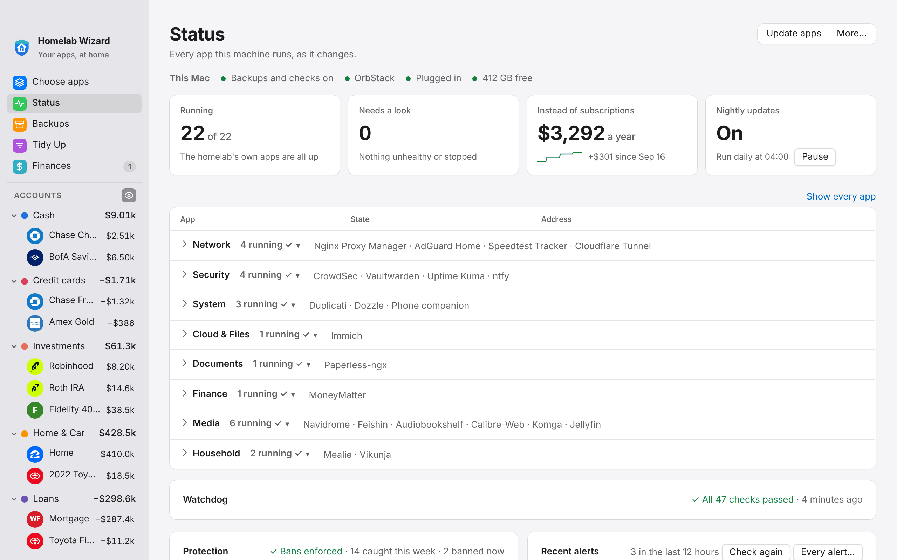
</picture>

Further down, the same screen shows the watchdog's checks, what CrowdSec blocked, recent alerts, **This week**'s summary, what each person and app keeps on disk, and a live line of what each busy app uses right now.

<picture>
  <source media="(prefers-color-scheme: dark)" srcset="images/app-status-cards-dark.png">
  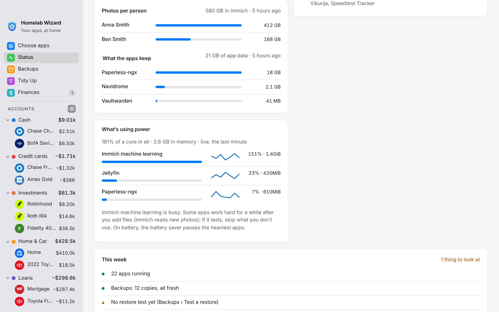
</picture>

When something is wrong, **Fix it** shows a plan and puts it right. More: [Monitoring](<Monitoring.md>), [Troubleshooting](<Troubleshooting.md>).

## An app's page

A click on any row on Status. Everything about one app: its state with **Restart**, **Stop**, and **Open**; its address (with a QR code to open it on a phone); what it uses now and its week as the watchdog saw it; its last backup; its log, with **Explain this** to have the AI on this computer say in plain words what it shows; its updates, with **Roll back**; who in the household uses it; and its own settings.

<picture>
  <source media="(prefers-color-scheme: dark)" srcset="images/app-page-dark.png">
  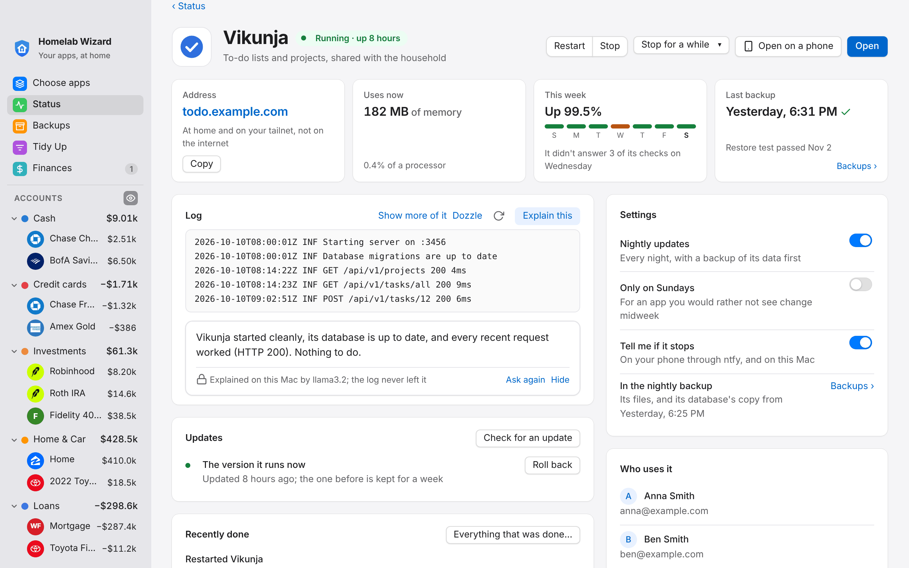
</picture>

The log never leaves the house: **Explain this** uses Ollama on this computer, never a cloud service.

<picture>
  <source media="(prefers-color-scheme: dark)" srcset="images/app-logs-dark.png">
  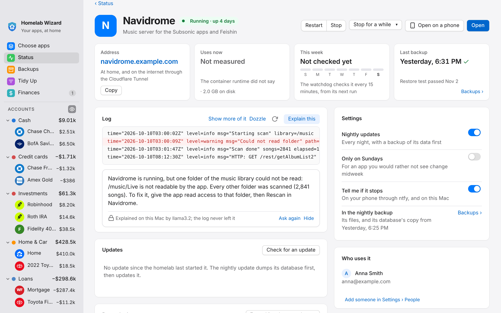
</picture>

More: [Monitoring](<Monitoring.md>), [Automation](<Automation.md#nightly-updates-the-background-agent>).

## Choose apps

Where the homelab grows. **Start here** has the five things most homes want first (Photos, Passwords, Movies and TV, Music, Files); **Add more** lists every app by category, each saying what it does and which subscription it can replace. Tick what you want, or pick a preset. The plan on the right says in one line what it will install, names any setting an app needs first, and warns if the apps wouldn't fit in this computer's memory. Then **Install**.

<picture>
  <source media="(prefers-color-scheme: dark)" srcset="images/app-choose-dark.png">
  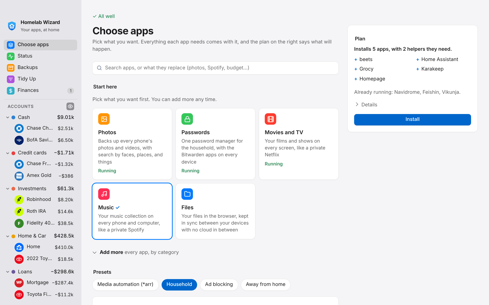
</picture>

More: [Services](<Services.md>), every app's own page.

## Setup

On a new computer, Setup is where the app opens: it checks for the container engine, then **Set it up for me** makes the homelab folder, with a strong password for every app.

<picture>
  <source media="(prefers-color-scheme: dark)" srcset="images/app-firstrun-dark.png">
  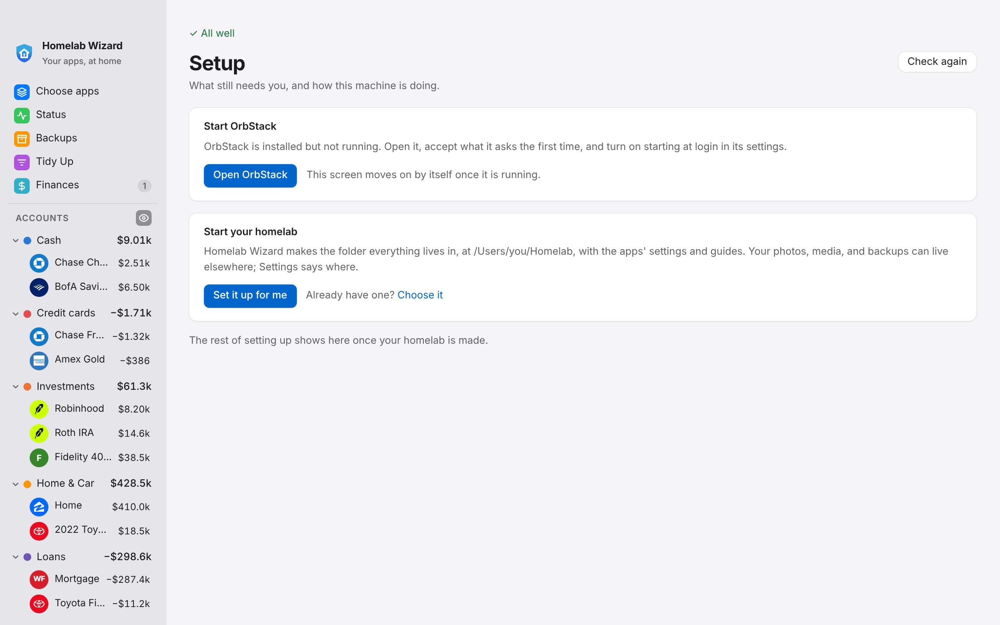
</picture>

After that, it's the checklist for finishing up, checked live: private addresses on your tailnet, the password manager's accounts, where backups go, alerts on the phone. Each step says first what it gives you. **Do the N I can do for you** runs every step that's ready; the rest say in one line what only you can do. Once everything is done, Setup leaves the sidebar, and comes back by itself if a step comes undone.

<picture>
  <source media="(prefers-color-scheme: dark)" srcset="images/app-setup-dark.png">
  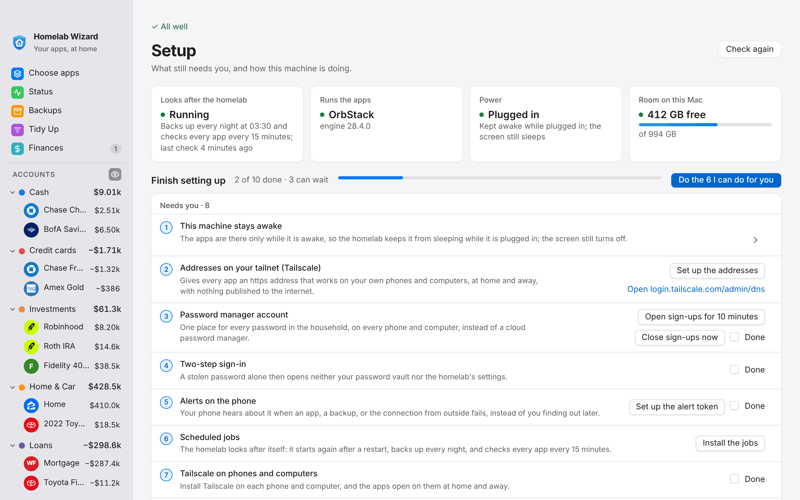
</picture>

More: [Getting Started](<Getting Started.md#2-work-down-the-setup-screen>).

## Backups

Each app's newest copy, the encrypted off-site jobs, and the last restore test: once a month the app restores a sample and checks it against the live files, so a backup is proven, not assumed. **Back up now**, **Test a restore**, the printable **Recovery kit** (where the backups and passphrases are), and **Move out…** / **Move in…** for a new computer.

<picture>
  <source media="(prefers-color-scheme: dark)" srcset="images/app-backups-dark.png">
  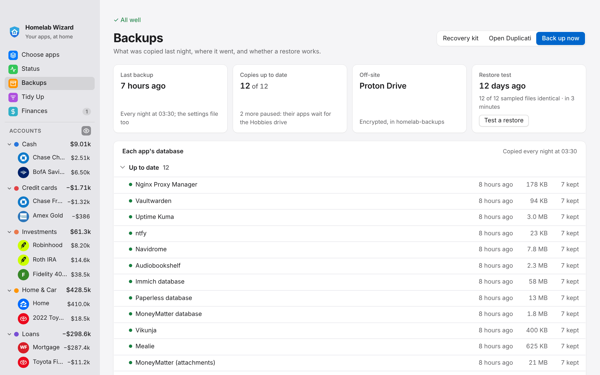
</picture>

More: [Backups](<Backups.md>), [Disaster Recovery](<Disaster Recovery.md>).

## Finances

A screen of the app itself, not a separate app: the household's money, typed in by hand and kept on this computer, with no bank connection. The Dashboard takes one paycheck at a time: checking now and after the next paycheck, every account after that paycheck's bills, and what's left.

<picture>
  <source media="(prefers-color-scheme: dark)" srcset="images/app-finances-dark.png">
  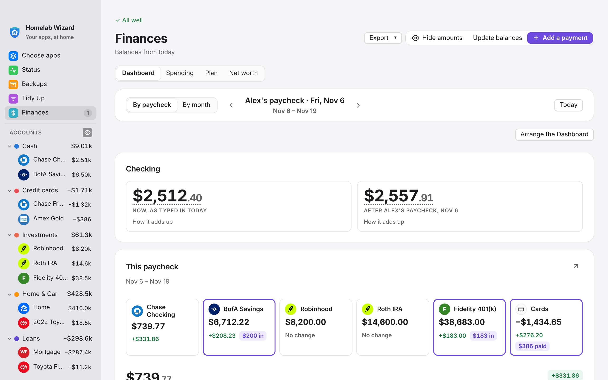
</picture>

**Net worth** draws it month by month, with a home's and a car's equity beside what's still owed on them.

<picture>
  <source media="(prefers-color-scheme: dark)" srcset="images/app-finances-worth-dark.png">
  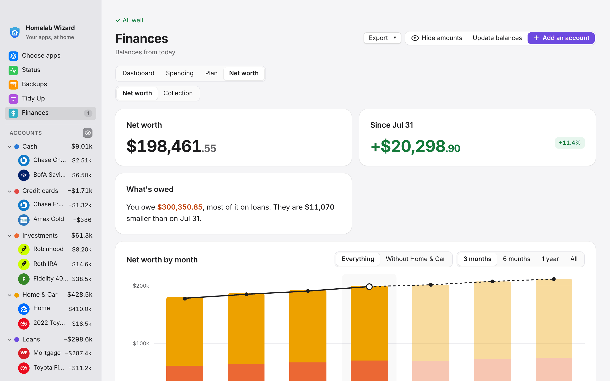
</picture>

**Plan** holds the calendar, the payments that repeat, and each person's paycheck: take-home, the deductions, and where it goes.

<picture>
  <source media="(prefers-color-scheme: dark)" srcset="images/app-finances-pay-dark.png">
  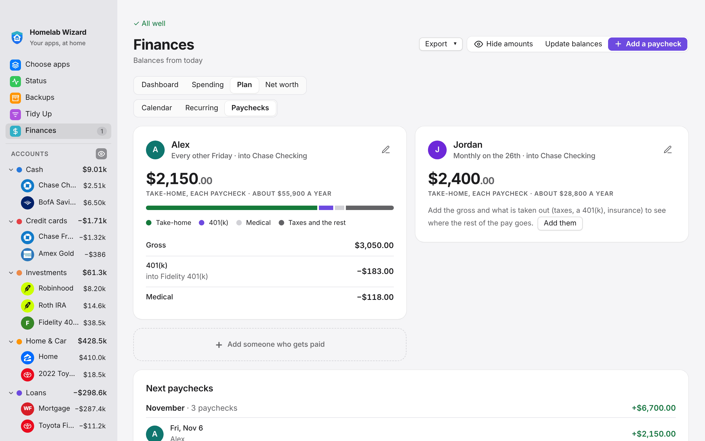
</picture>

**Spending** keeps what actually happened (transactions with receipts, budgets, and reports by category, payee, and month). Phones you allow can see or change Finances too, and the file goes off-site with the nightly backup, encrypted. More: [the phone companion](<../services/system/Phone companion.md>).

## Tidy Up

Also a screen of the app itself. It keeps the music, films, shows, books, and audiobooks on the media drive sorted, tagged, and lean. Drop a download into a folder it watches and it works out what it is, cleans it up, and files it in the right library, as things arrive, once a day, or when you press **Tidy up now**.

<picture>
  <source media="(prefers-color-scheme: dark)" srcset="images/app-tidy-dark.png">
  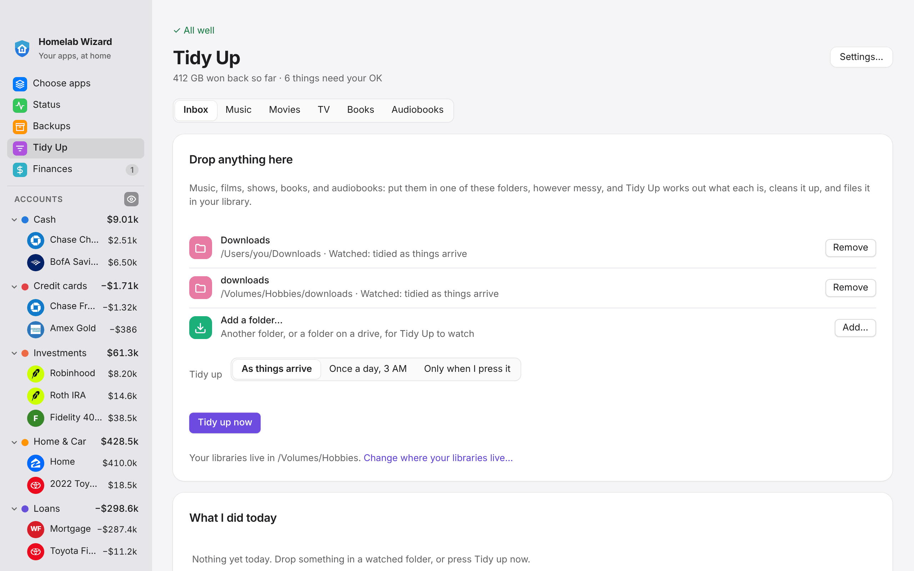
</picture>

Each library has a tile saying what it holds and how far along it is, beside the genres and what was done recently, each with **Undo**.

<picture>
  <source media="(prefers-color-scheme: dark)" srcset="images/app-tidy-genres-dark.png">
  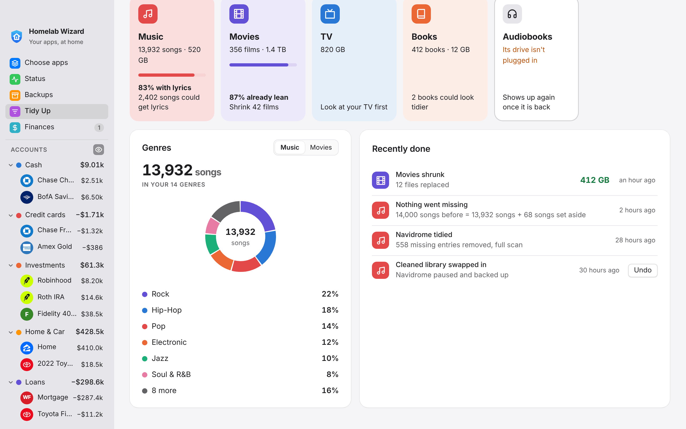
</picture>

Each library's tab has its own clean-up. Music is rebuilt with beets step by step (scanned, built, swapped in, checked, freed), with lyrics and playlists; films and shows are shrunk with Tdarr; books are tidied in Calibre; an audiobook in many files becomes one. Anything thrown away goes to the Trash first.

<picture>
  <source media="(prefers-color-scheme: dark)" srcset="images/app-tidy-music-dark.png">
  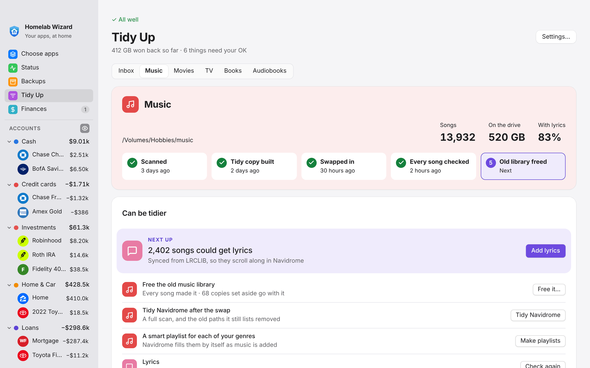
</picture>

More: [Tidy Up](<Tidy Up.md>).

## Settings and phones

Every setting of the homelab as a form, the everyday ones first, searchable. Passwords and tokens are never shown back: **Test** checks one, **Copy** hands it to the password manager. **This Mac** has the machine and its updates; **Appearance** the theme, accent, and contrast; **People** gives each person their own sign-in and a welcome page.

<picture>
  <source media="(prefers-color-scheme: dark)" srcset="images/app-settings-dark.png">
  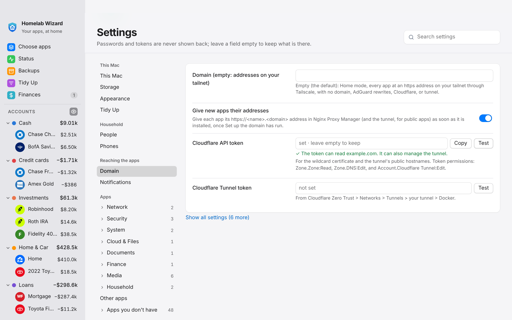
</picture>

**Phones** pairs a phone with a QR code. A phone can only look until you let it make changes, and sees Finances only if you choose that for it.

<picture>
  <source media="(prefers-color-scheme: dark)" srcset="images/app-phones-dark.png">
  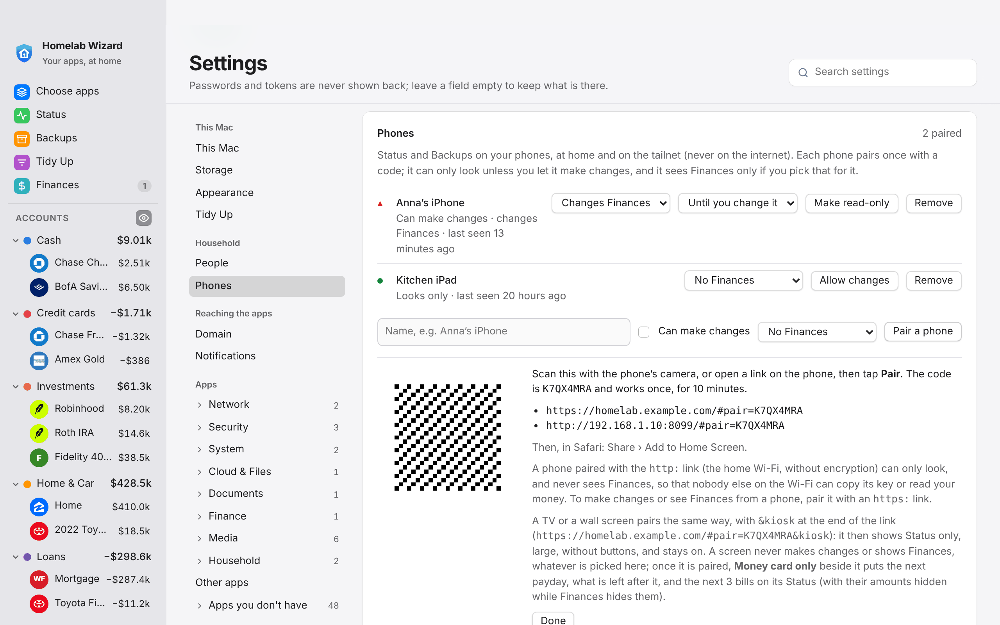
</picture>

More: [Environment](<Environment.md>) (every setting), [Pocket ID](<../services/security/Pocket ID.md>) (sign-in for the household).

## On your iPhone

The **Homelab app** for iPhone and iPad is how the household keeps an eye on the homelab: the same homelab in your pocket, at home or away. It opens behind Face ID, and a phone only looks until you let it make changes (Settings › Phones on the computer); then Start, Restart, or a backup asks Face ID first.

**Status** leads with what needs a look, with **Start** and **Logs** right there, then each category folded into one line. A tap on any app opens its page: its state, **Open**, **Restart**, **Stop**, its log, and **Roll back**. **Backups** shows the last one, the restore test, and anything stale.

  <picture>
    <source media="(prefers-color-scheme: dark)" srcset="images/iphone-status-dark.png">
    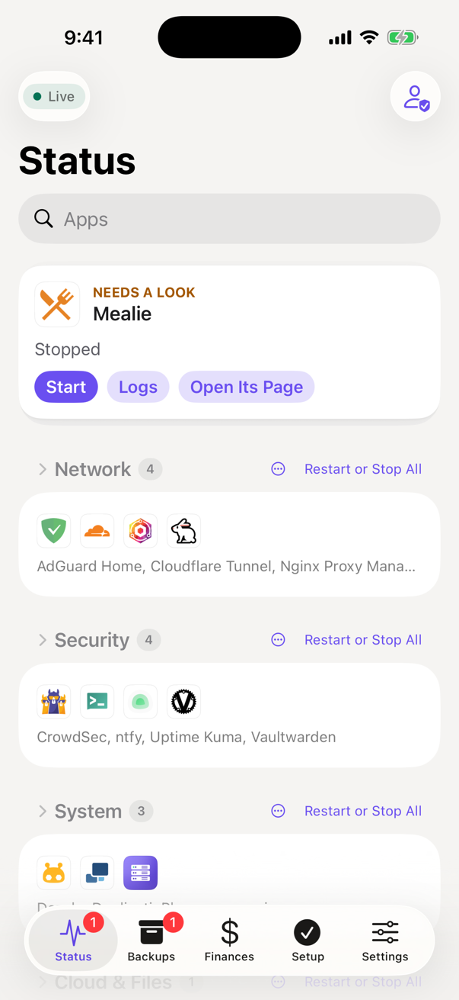
  </picture>
  <picture>
    <source media="(prefers-color-scheme: dark)" srcset="images/iphone-app-dark.png">
    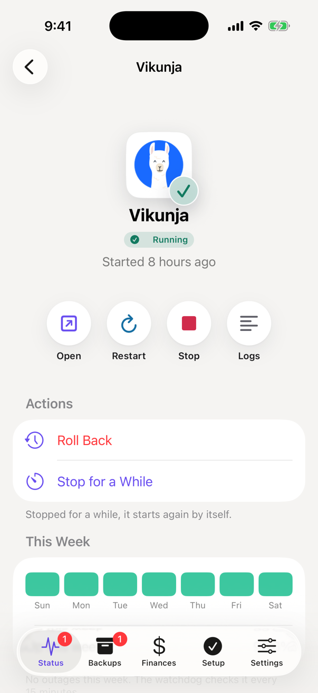
  </picture>
  <picture>
    <source media="(prefers-color-scheme: dark)" srcset="images/iphone-backups-dark.png">
    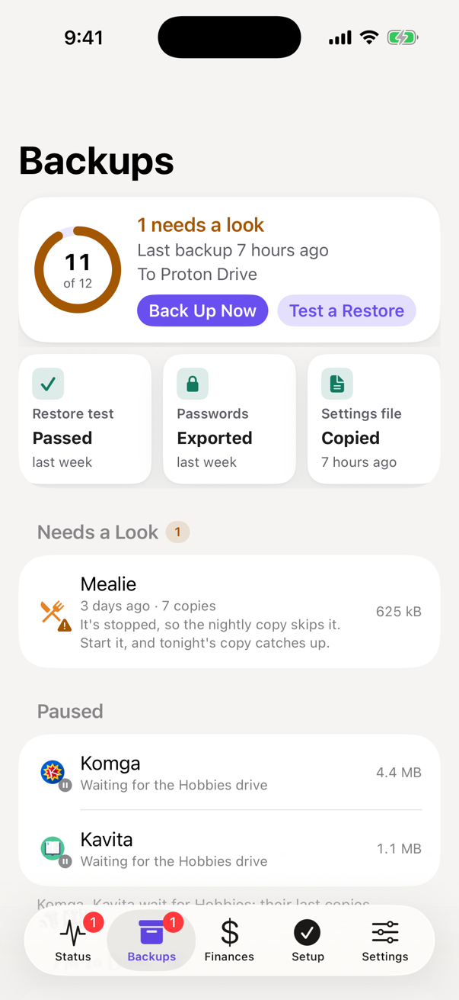
  </picture>

**Finances**, on the phones you allow, is laid out as the phone's own Settings: checking now and after the next paycheck, net worth over three months, then Transactions, Budgets, Investments, and the rest, each a tap away. Without a connection it shows the last Finances it read, marked **As of**, to look at.

  <picture>
    <source media="(prefers-color-scheme: dark)" srcset="images/iphone-finances-dark.png">
    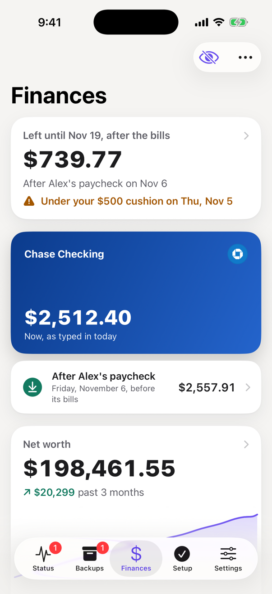
  </picture>
  <picture>
    <source media="(prefers-color-scheme: dark)" srcset="images/iphone-transactions-dark.png">
    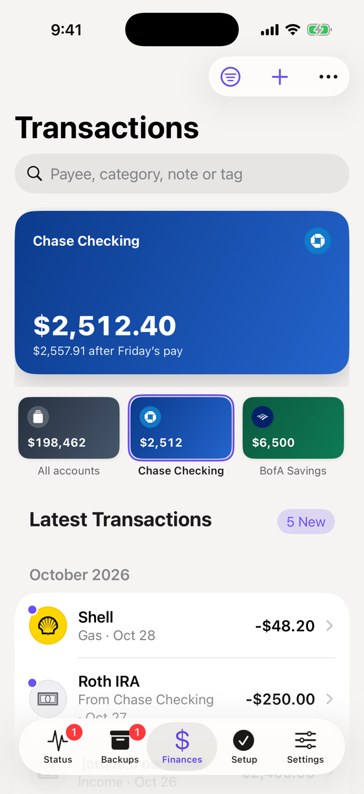
  </picture>
  <picture>
    <source media="(prefers-color-scheme: dark)" srcset="images/iphone-spending-dark.png">
    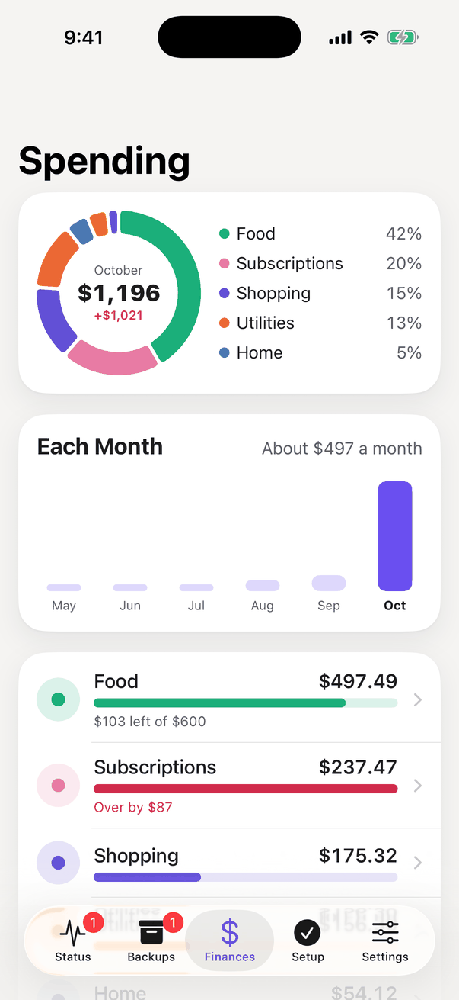
  </picture>

  <picture>
    <source media="(prefers-color-scheme: dark)" srcset="images/iphone-budgets-dark.png">
    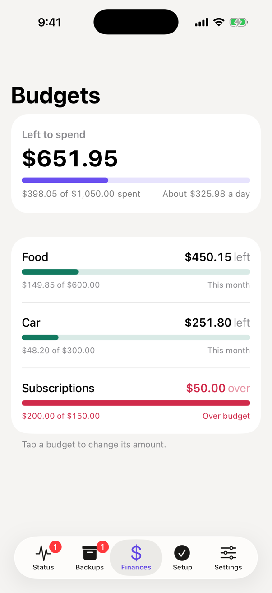
  </picture>
  <picture>
    <source media="(prefers-color-scheme: dark)" srcset="images/iphone-investments-dark.png">
    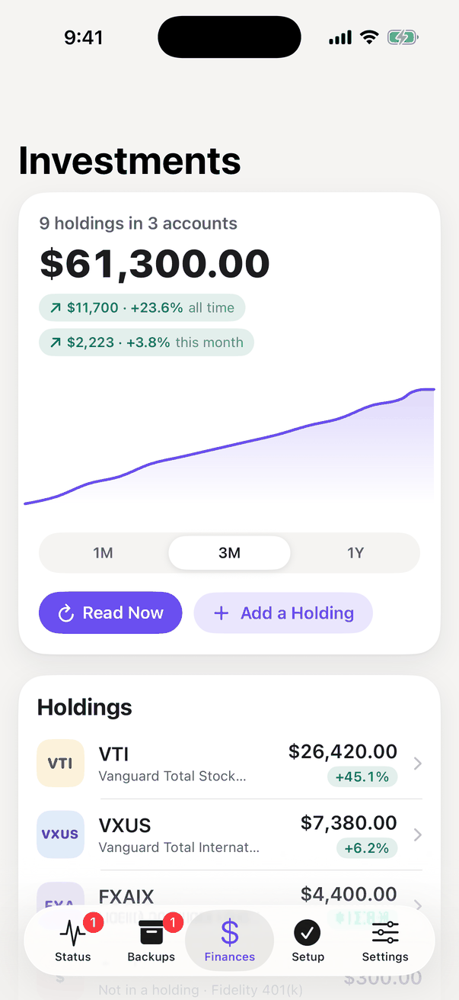
  </picture>

It locks itself whenever you leave it, and **Settings** has the homelab's everyday settings, each change asking Face ID.

  <picture>
    <source media="(prefers-color-scheme: dark)" srcset="images/iphone-lock-dark.png">
    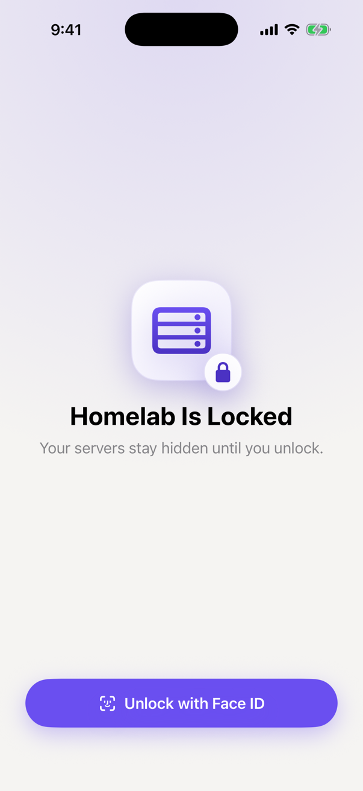
  </picture>
  <picture>
    <source media="(prefers-color-scheme: dark)" srcset="images/iphone-settings-dark.png">
    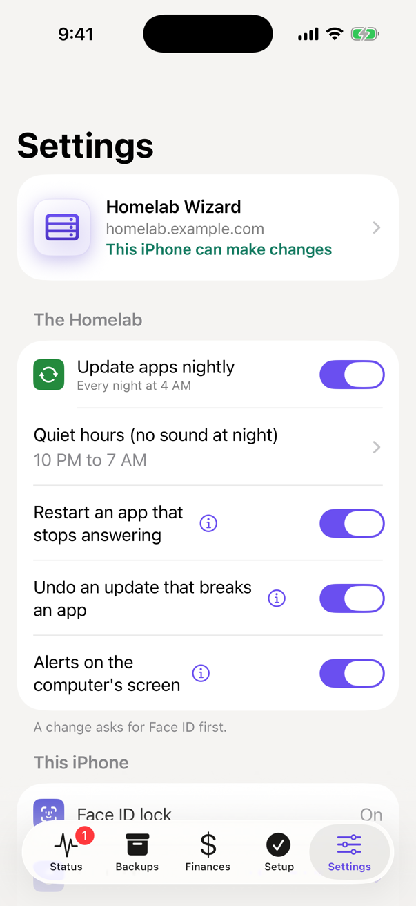
  </picture>

It's built with Xcode on your own Mac for now, not from the App Store: [apple-client](<../apple-client/README.md>) has the steps. Any other phone (Android, a visitor's) can open the same Status, Backups, and Finances in its browser once paired. What each device can do: [What each device can do](<Parity.md>).

## Updates

The app looks for a new version every 15 minutes. When there is one, a line at the top of the window says so: **What's new** shows the patch notes, **Update now** puts it in place and opens it again, keeping your settings, data, and own apps. The apps themselves update overnight, each with its data copied first, and one that comes back unwell is rolled back by itself.

<picture>
  <source media="(prefers-color-scheme: dark)" srcset="images/app-update-dark.png">
  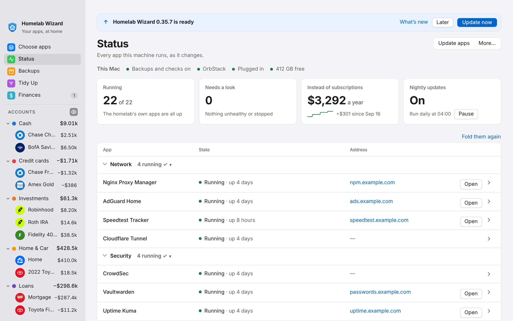
</picture>

More: [Upgrading](<Upgrading.md>).

## And from a terminal

Everything the app does, `homelab` does from a terminal too, with a plan shown before anything changes: `./homelab status`, `./homelab install <app>`, `./homelab fix`, `./homelab backup`, `./homelab media`. Every command: [Commands](<Commands.md>).
