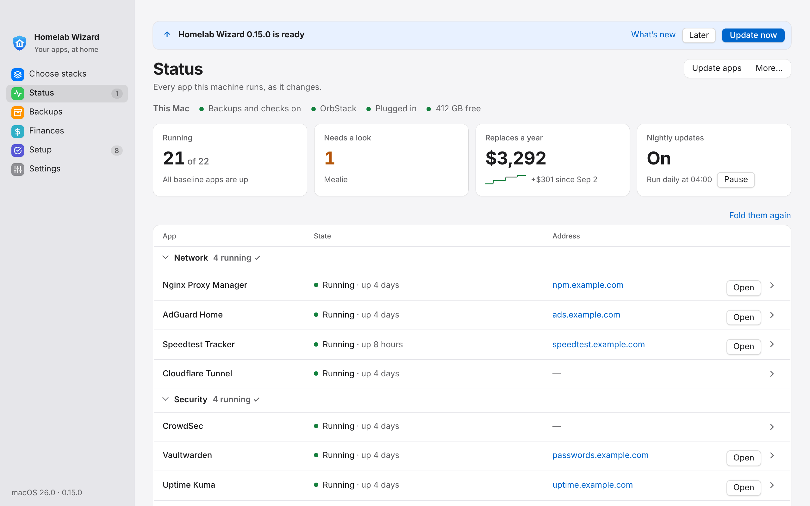

# Upgrading

What to do after pulling a newer version, and what each batch of changes asks of you. The newest batch is at the top; once you have done its steps, nothing below it applies again. For what each version changed, read the [CHANGELOG](<../CHANGELOG.md>); this page is only what you need to do.

## Every time

In the app there is nothing to look for. Homelab Wizard looks for updates by itself, the homelab files and its own build together: every 15 minutes while it runs, and when you bring its window forward. What it finds it downloads at once. Then one line at the top of every screen says *Homelab Wizard 0.15.0 is ready* (the version, when it has one), with **What's new**, **Later**, and **Update now**; the menu bar item says *Update to 0.15.0*.

**Update now** moves the homelab files forward and starts the homelab again, then puts the new app in place (checked against GitHub's SHA-256 checksum) and opens it again on the same screen: the line says *Updating…* with a bar, then *Updated to 0.15.0*. Your apps keep running. **Later** hides the line until something newer turns up; the sidebar's **● Update ready** brings it back. On the testing channel the build is the latest one (Releases › Latest, rebuilt from every change to main); on stable the newest `v*` release. On Windows and Linux it is the one for how the app was installed (the installer or portable zip, the AppImage, or the .deb, .rpm, or Arch package).

Quitting the app also puts a downloaded update in place, so the next open is the new version (Settings › This Mac › Updates › *Install updates when I quit the app*, on unless you turn it off). An app in Program Files (the Windows installer's) and a Linux package ask for an administrator's approval or password, so there they are installed with **Update now** only. Each attempt's steps are kept in `update.log` ([Troubleshooting](<Troubleshooting.md#the-desktop-app>)). When an update cannot finish by itself (the homelab folder has changes of its own, or this copy of the app cannot replace itself), the line says why in one sentence, and offers the download when there is one. **Look now** in Settings › This Mac, or Setup's **Check again**, looks at once.

In Terminal:

```sh
cd ~/Homelab
./homelab upgrade
./homelab doctor
```

- A folder the app made with **Set it up for me** has no git: `upgrade` compares it with the homelab files inside the app instead, so a new app build brings the update. When the new app opens, it puts those files in place by itself (the line says *Finishing the update…*), so updating is one step. It keeps `.env`, data, and your own apps, and a file you edited that the update also changes is saved beside it as `.local`.
- `upgrade` lists the changes waiting on GitHub and what is new in the CHANGELOG, says whether the desktop app or the settings changed, and asks before going ahead. It then moves the folder forward (fast-forward only: your own edits are never merged or overwritten; when the update changes a file you edited, git stops and nothing changes), rebuilds the CLI, and runs `up`.
- `up` adds any new settings from `.env.example` to `.env` (generating new secrets), and recreates apps whose compose definition changed. It never touches values you already have.
- `doctor` ends without ✗ lines.
- Which changes you get is `UPDATE_CHANNEL` in Settings: `testing` (every change on `main`) or `stable` (tagged releases only, from the first release on).
- Something wrong after an upgrade: `./homelab upgrade --back` (or *go back to …* beside the version in Settings › This Mac) returns the homelab files to where they were before it, then runs `up`. Settings, data, and your own apps stay. Undo one app's nightly image update with `./homelab rollback <app>` instead.
- Before `upgrade` existed (release run 5 and earlier), the same is `git pull`, then `./homelab up`.

<picture>
  <source media="(prefers-color-scheme: dark)" srcset="images/app-update-dark.png">
  
</picture>

## After 0.15.0: Finances, and a rebuild in one command

**Update now** as usual; nothing else is required. What to expect:

- **Finances** joins the sidebar, empty until you type in an account, a paycheck, and a payment. Its file (`data/finance.json`) goes off-site with the nightly backup inside the encrypted Secrets job, as the household and the phones do.
- Finances show on no phone until you pick **Sees Finances** or **Changes Finances** beside it in Settings › Phones (or `./homelab phone finances <id> view`). A phone paired with the `http:` link never gets them: pair it again with the https link first.
- On Windows, if updating went round in a loop (the app closed, opened again, and was still the old version), the fix is in the new build's own updater, which the old one cannot run: download `Homelab-Wizard-Windows-Setup.exe` from Releases › Latest and run it once (SmartScreen: **More info** › **Run anyway**). Later updates go in by themselves, asking for an administrator's approval only when the app is in Program Files.
- `./homelab rebuild <backup folder>` is new: nothing to do now, but it is the first thing to reach for if the machine is ever lost ([Disaster Recovery](<Disaster Recovery.md#scenario-full-mac-rebuild>)).

## After 0.15.0: each app's version is kept in .env

**Update now** as usual; nothing else is required. Within 15 minutes (the watchdog's next run) `.env` gains, under the heading *The version each app runs*, one `<APP>_DIGEST` line for each app the nightly update moves forward: the image it runs and that image's digest. A version you set by hand (`IMMICH_VERSION`) still wins. `homelab update` and a rollback keep them current, and `homelab up`, a move, and `homelab rebuild` start those versions again, so data restored on a new machine is opened by the version that wrote it, not the newest. Delete an app's line to let it start on its newest version.

## After 0.14.0: the homelab talks to Docker directly

**Update now** as usual; nothing else is required. What to expect:

- `up` adds `DOCKER_API=auto` to `.env`: the homelab reads the containers, their events and what they use, and runs commands in them (the nightly database copies), through Docker's own API rather than the docker command. Starting, stopping and updating apps is still `docker compose`.
- `./homelab doctor` says which is in use (*reads the containers through the engine's API at …*), and the last time the API failed and the docker command answered instead. If something reads wrong, set **DOCKER_API** to `off` in Settings (or `.env`) to go back to the docker command, and send the diagnostics report.
- Status keeps itself current: the background agent sends each change with the Status after it, so a screen no longer asks again when you open it. Nothing to set.

## After 0.14.0: Watchtower goes

**Update now** as usual (the line at the top of the window, or `./homelab upgrade`); nothing else is required. What to expect:

- Starting the homelab removes Watchtower's container (`homelab_system-watchtower-1`) and its image, saying so: the background agent runs the nightly updates now, at the same time (`WATCHTOWER_SCHEDULE`, 4:00 by default), copying each app's data before its update so a rollback can put it back.
- Every app updates nightly unless it is pinned (its note says why), a database, or built here, as before; held apps (`UPDATES_HELD`) and **Pause nightly updates** work as before. `WATCHTOWER_VERSION` and `UPDATES_HELD_CONTAINERS` in `.env` are no longer used and can go.
- The phone keeps getting the nightly summary on the `watchtower` topic.

## After 0.14.0: updates find themselves, and take one step

**Update** this one last time as before (Setup, or `./homelab upgrade`); from then on the line at the top of the window does it, as *Every time* says. What changes:

- No more **Check again** to see an update: the app looks every 15 minutes and when the window comes forward, and downloads what it finds.
- Setup's update card and the *Restart to update* banner are gone: one line at the top of every screen, and **Update now** does the homelab files and the app together. Setup no longer comes back into the sidebar for an update.
- *Install updates when I quit the app* is on unless you turned it off; it moved to Settings › This Mac › Updates, with **Look now**.
- The menu bar item's update line says *Update to 0.15.0*, and opens the window to put it in place.

## 23 October 2026: Status follows live, and the homelab heals

**Update** as usual (Setup, or `./homelab upgrade`); nothing else is required. What to expect:

- The update recreates six containers once, so background work yields the CPU to the apps in use: Duplicati, Immich's machine learning, qBittorrent, Dawarich's worker, Karakeep's crawler, and Speedtest Tracker. Each is down for a few seconds. If Status still shows *settings changed* on one afterwards, **Fix it** recreates it.
- Two new settings are added to `.env`: `AUTO_HEAL=true` (the watchdog restarts an app that hangs, once in 6 hours at most; `false` makes it alert only) and `OLLAMA_MODEL`, empty (which model **Explain this log** uses).
- Watchtower and `docker-socket-proxy` stop updating themselves: they control Docker, so they now stay on a version you choose (`WATCHTOWER_VERSION=1.23.2`, `SOCKET_PROXY_VERSION=v0.5.0`, added to `.env`). These are the versions they run today, so they are recreated once and nothing else changes. To update one later: read its release notes, change the setting, then `./homelab update watchtower` (or `docker-socket-proxy`).
- On Linux, add your account to the `docker` group if Setup's first step says so (then log out and back in); on Windows, to `docker-users`.

What is new:

- Status changes the moment an app starts, stops, or changes health, on the computer, in the menu bar, and on paired phones. Longer jobs show a progress bar.
- An app that runs but whose page does not answer shows *Not answering* (with why); one still running settings you have since changed shows *settings changed*. **Fix it** handles both.
- **Update** on an app shows its release notes first (`./homelab updates notes <app>`). An update that leaves an app not answering is rolled back by itself, as one that leaves it unhealthy was.
- **Explain this log** in an app's Logs panel, with Ollama and a model on this machine (`ollama pull llama3.2`); `./homelab logs <app> --explain` does the same.
- Kiosk mode: pair a TV or a wall tablet like a phone, with `&kiosk` at the end of the pairing link (Settings › Phones shows it).
- The power card shows each busy app's last five minutes.
- Typed values in Settings survive a search or a change of page, and live updates keep the keyboard's place.
- For scripts: `--json` output includes `step` lines for longer jobs (`{"type":"step","data":{"n":2,"total":5,"text":"…"}}`).

## 16 October 2026: the app updates itself

From this build on, Setup › **Update** also replaces the app on a Mac, so there is no more downloading from GitHub Actions. An app from before this change cannot do that yet: if Setup says *A newer Homelab Wizard is ready* with **Open the release builds**, download it this one last time from GitHub › Releases › **Latest** (`Homelab-Wizard-macOS.dmg`), drag it to Applications, and clear the download flag:

```sh
xattr -dr com.apple.quarantine "/Applications/Homelab Wizard.app"
```

Nothing else to run. What is new:

- Setup › **Do the steps I can** runs every ready step in turn. Each step now says what it gives you first.
- Status: categories where everything runs fold into one line; each app row has a phone button (its address as a QR code) and, for the proxy, AdGuard, Duplicati, and PsiTransfer, a key button with the sign-in. **This week**, **What the apps keep**, and an *x% up this week* badge are new. **Protection** has **Fix** when the proxy stops enforcing CrowdSec's bans, and the watchdog card has **Fix it**.
- Settings shows the everyday settings first (**Show all settings** for the rest), and **People** adds and removes household members (it needs Pocket ID).
- Backups › **Moving to a new machine**: **Move out…** and **Move in…**.
- Choose stacks has a shorter plan (the rest under **Details**), and the *Media automation* preset now includes qBittorrent with Gluetun, its VPN, and Seerr.
- Tailscale needs no auth key: Setup's tailnet step (or `./homelab tailnet login`) opens Tailscale's sign-in page. A `TAILSCALE_AUTHKEY` you already set still works.
- With a domain, on a Mac: Setup › **This Mac finds its apps by name** (`./homelab domain resolver`) writes `/etc/resolver/<domain>`. Once it is ✓, lines you added to `/etc/hosts` for the apps, or a DNS server set by hand on the Mac, can go.
- In Home mode, `TAILNET_ADMIN_APPS=false` (Settings › Admin apps on the tailnet) keeps the proxy, AdGuard, Duplicati, and Dozzle off the tailnet; the next `./homelab tailnet setup` or install applies it.
- Cmd and + or − (Ctrl on Windows and Linux) change the text size; Cmd and 0 goes back.
- For scripts: every `--json` line now carries `"schema": 1`.

## 16 October 2026: Home mode is the default

Nothing to do. A new homelab starts in Home mode (`HOMELAB_DOMAIN` empty: every app at its address on your tailnet). Your `.env` keeps its domain; only `.env.example`'s default changed.

## 16 October 2026: CrowdSec starts again

If Status showed CrowdSec *restarting* (with a growing *restarted N×* badge), `./homelab upgrade` fixes it: it picks up the new AppSec setting the next time CrowdSec restarts, which it was doing every few seconds. Status then shows it running, and `./homelab doctor` no longer says the bouncer last pulled decisions days ago.

## 15 October 2026: the public repository

The project now lives in a public repository, [Snooper42/homelab-wizard](https://github.com/Snooper42/homelab-wizard), with `example.com` and neutral examples in its docs. A homelab folder cloned from the earlier private repository switches over once, in Terminal:

```sh
cd ~/Homelab
git remote set-url origin https://github.com/Snooper42/homelab-wizard.git
git fetch origin
git reset --hard origin/main
./homelab up
```

`.env`, `data/`, `appdata/`, and your own apps (`stacks/custom`) are not in git, so they stay as they are, and your real domain and folders keep coming from `.env`. The reset replaces only the homelab's own files (an edit you made to one of them is lost; `git stash` first keeps it). From then on, `./homelab upgrade` and Setup › **Update** follow the public repository. A folder made with **Set it up for me** has no git and needs nothing.

## 15 October 2026: single sign-on

`up` generates `POCKET_ID_API_KEY` and restarts Pocket ID with it, and restarts Karakeep, Open WebUI, Paperless-ngx, Mealie, Vikunja, and Immich once (they can now read sign-in settings and reach Pocket ID through the proxy). Nothing changes how people sign in until you run `./homelab sso setup`.

## 15 October 2026: database versions as settings

Paperless's, Ghostfolio's, RomM's, Docmost's, and MoneyMatter's databases now take their PostgreSQL major version from `.env` (`up` adds the settings with the versions they run now), and all but Paperless's set `PGDATA` to the folder they already use. The next `up` restarts those database containers once, which takes a few seconds; nothing else changes. Move to a new major version with `./homelab db upgrade <database>` only.

## 15 October 2026: updates you can undo

The nightly backup moves from 04:30 to 03:30, before Watchtower, so every update has a fresh dump behind it: click **Install the jobs** on Setup again (or `./homelab schedule install`). `./homelab upgrade` restarts Watchtower with its new settings (it keeps old images now, and the watchdog tidies them). Rollbacks work for updates from then on.

## 15 October 2026: the phone companion

A fifth scheduled job runs the phone companion. Setup's **Scheduled jobs** step shows 4 of 5 until you click **Install the jobs** again (or `./homelab schedule install`). It listens on port 8099 for the home network and the tailnet only, and shows nothing until a phone is paired (`./homelab phone pair`). Set `PHONE_COMPANION=false` in Settings first if you would rather not have it. Then **Set up the domain** once more (or `./homelab domain setup`) gives it `https://homelab.<domain>`; in Home mode the next install, or `./homelab tailnet setup`, gives it the tailnet address.

## 15 October 2026: Home mode, a starter pick, two new apps

Nothing to do for a homelab with a domain. `upgrade` adds empty `*_URL` settings (each app's own address, used in Home mode) and `HOMELAB_BASELINE`; empty keeps everything as it was. Homepage restarts once on the next `up` because its list of allowed names grew.

Two optional apps: Docmost (the household wiki) and Dawarich (location history). Install either from Choose stacks › Add more.

## 15 October 2026: ad blocking on the tailnet

A new optional app, `tailnet-dns`, lets every phone and computer signed in to Tailscale use AdGuard Home, at home and away, with no router or Wi-Fi setting. Nothing changes until you install it (Choose stacks › **Ad blocking**, or `./homelab install @adblock`); then do what the install shows in the Tailscale admin console › DNS. Setup's AdGuard step now has **Set up AdGuard**, which answers AdGuard's first-run wizard for you; a login you already made stays as it is.

## 15 October 2026: one Compose project per category

Each category is now its own Compose project, so OrbStack shows the containers grouped as Network, Security, System, Media, and so on, instead of one long *homelab_core* list. The containers move once:

```sh
cd ~/Homelab
./homelab upgrade
```

`upgrade` runs `homelab migrate` before `up`: it backs up first (as the nightly job does), then removes each container from `homelab_core` and starts the app again in its category's project. Settings and data stay where they are: the folders under `data/` and the named volumes keep their names. Apps you had stopped are left stopped. Afterwards `./homelab doctor` no longer mentions `homelab_core`, and the app's Status shows every app as before.

To move them without the rest of the update: `./homelab migrate` shows the plan, `./homelab migrate --apply` does it.

## 15 October 2026: keep awake

A fourth scheduled job keeps the Mac from sleeping while it is plugged in. Setup's **Scheduled jobs** step shows 3 of 4 until you click **Install the jobs** again (or `./homelab schedule install`). Set `KEEP_AWAKE=false` in Settings first if you would rather it slept.

## 15 October 2026: one Compose file per category

The core apps moved out of `compose.yaml` into `compose/<category>.yaml`. They stay in the same Compose project, so nothing is recreated and no step is needed. If you edited `compose.yaml` by hand, `upgrade` stops and says so (fast-forward only); move your edit into the category's file in `compose/` after the update, or into your own apps with `homelab custom`.

## 15 October 2026: new apps

Ten optional apps: Baikal, PairDrop, PsiTransfer, Pocket ID, Wallos, Changedetection.io, Memos, Homebox, RomM, and Ghostfolio. Install any from Choose stacks. RomM looks for games on the media drive under `games/roms/<platform>`.

- There is a new alert topic, `reminders`, for notifications from the apps themselves (Wallos renewals, Changedetection.io). Run **Set up the alert token** on Setup again (or `./homelab notify setup`) so the homelab may publish to it, then subscribe to `reminders` in the ntfy app on the phone.

## 15 October 2026: new categories

The apps are regrouped: Network, Security, System, Cloud & Files, Documents, Finance, Media, Media Automation, and Household. Nothing running changes and no step is needed.

- Each app's note moved to its new folder under `services/` (for example `services/infrastructure/Duplicati.md` is now `services/system/Duplicati.md`). A bookmark to an old note needs updating.
- Your own apps (`stacks/custom`) keep working: `infrastructure`, `productivity`, and `home` count as System, Documents, and Household. New ones made with **Add your own app** use the new names.
- `./homelab install cat:<id>` takes the new ids (`cat:network`, `cat:household`, and so on).

## 11 October 2026: native look, disk space, restore drills

Setup › **Update** (or `./homelab upgrade`), then the newest app build. Nothing else to run.

- The app follows each platform: on the Mac the window buttons sit in a translucent sidebar, and the menu bar gains View (Settings… on ⌘,) and Help. Windows 11 and Linux get their own look.
- The watchdog now checks the free space on each disk the homelab writes to, so the first run after the update can alert if one is already low ([Troubleshooting](<Troubleshooting.md#backups-and-jobs>) says where space usually hides). Setup › Disk space shows each disk.
- Each restore test goes on record with how long it took (Backups). Earlier tests are not in the record; the next one starts it.
- Backups shows when each Duplicati job runs next.

## October 2026: the app grows up (after release run 4)

This one time, pull by hand (`upgrade` arrives with it): `git checkout main`, `git pull`, then `./homelab up`, and get the newest app build. From then on, Setup › **Update** or `./homelab upgrade` does it.

**New in the app**

- Status: restart, update, stop, and logs for each app, with what needs a look first. It also shows recent alerts and the savings trend.
- Backups: each app's newest copy, each Duplicati job's last run, **Back up now**, and **Test a restore**.
- Setup: **Use Proton Drive**, **Create the backup jobs**, and the homelab's own updates (**Update**), including when the app itself has a newer build.
- Settings: **Test** checks a login or token with its service; **Copy** hands a password to Vaultwarden without showing it.
- Elsewhere: search on Choose stacks, and Show in Finder after a diagnostics report.
- Menu bar: the newest alert, the last backup, and *Update ready*.

**New in the jobs**

- Nightly backup: records the day's savings, reminds about the restore test and the vault export, asks GitHub for updates, and on Sundays sends *Homelab this week*.
- Watchdog: also alerts when a Duplicati job fails or stops running.
- With Homepage installed, its page lists every running app.

**New settings** (`up` adds them; all optional or generated): `NTFY_READ_TOKEN`, `NTFY_PHONE_PASSWORD`, `DUPLICATI_SECRETS_PASSPHRASE`, `DUPLICATI_PASSPHRASE`, `VIKUNJA_PORT`, `VIKUNJA_SECRET`, `MONEYMATTER_FRONTEND_IMAGE`, `MONEYMATTER_BACKEND_IMAGE`, `MONEYMATTER_PLATFORM`.

| If… | Then |
|---|---|
| You already ran **Set up the alert token** (`notify setup`) | Run it again. It keeps the publishers' token. It adds the read-only `homelab-reader` (for the app's recent alerts) and the `phone` login (`NTFY_PHONE_PASSWORD`; sign the phone's ntfy app in with it). It also gives every Duplicati job its alerts |
| You have not yet | Nothing extra: the step does all of that |
| You have not made the Duplicati jobs yet | Setup › **Create the backup jobs** makes them all. Then Settings › `DUPLICATI_SECRETS_PASSPHRASE` › **Copy** into Vaultwarden, and write it on the recovery kit |
| You made Duplicati jobs by hand | They stay as they are, and the per-job `send-http-url` can go (the alert token step sets it for every job). **Create the backup jobs** adds only jobs whose names are missing |
| Vaultwarden has accounts | Once a month, keep a password-protected export in `recovery-staging/secrets` ([Backups](<Backups.md#password-vault-export>)); the nightly backup reminds you |
| You want a start page for the household | Install Homepage (it comes with the *Household* preset); its list of apps keeps itself current |
| You want a to-do app | Install Vikunja from Choose stacks, then make each account with the command in [its note](<../services/household/Vikunja.md>) |
| You want MoneyMatter without Rosetta (optional, untried) | Follow [its note](<../services/finance/MoneyMatter.md#running-natively-on-apple-silicon-optional>); leaving the settings empty keeps it as it is |

Nothing else changes how the apps run: no image was swapped and no data moves.

## Before that

Release run 4 and earlier: follow [Testing](<Testing.md>) from the top.
