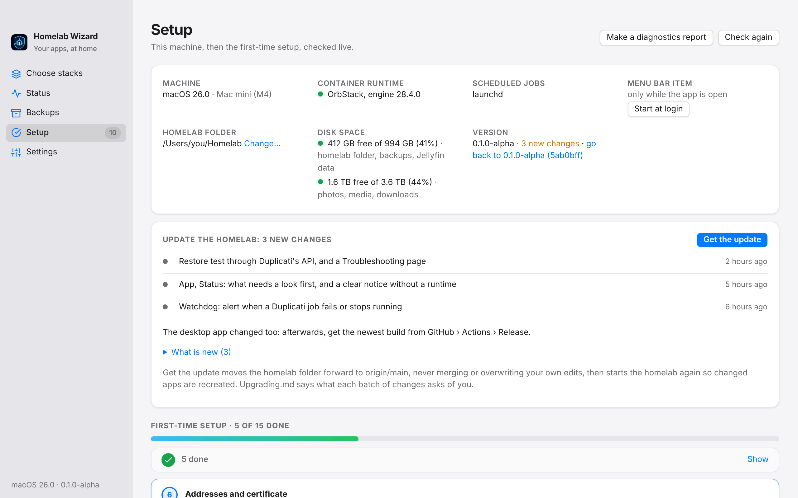

# Upgrading

What to do after pulling a newer version, and what each batch of changes asks of you. The newest batch is at the top; once you have done its steps, nothing below it applies again.

## Every time

In the app, Setup shows *new changes* beside the version when GitHub has any, with the list and **Get the update**. The menu bar says *Update ready* too: the nightly backup asks GitHub once a day. Setup also says when the app itself is older than the folder (*A newer Homelab Wizard is ready*), with a button to the release builds. In Terminal:

```sh
cd ~/Homelab
./homelab upgrade
./homelab doctor
```

- A folder the app made with **Set it up for me** has no git: `upgrade` compares it with the homelab files inside the app instead, so a new app build brings the update. It keeps `.env`, data, and your own apps, and a file you edited that the update also changes is saved beside it as `.local`.
- `upgrade` lists the changes waiting on GitHub and what is new in the CHANGELOG, says whether the desktop app or the settings changed, and asks before going ahead. It then moves the folder forward (fast-forward only: your own edits are never merged or overwritten; when the update changes a file you edited, git stops and nothing changes), rebuilds the CLI, and runs `up`.
- `up` adds any new settings from `.env.example` to `.env` (generating new secrets), and recreates apps whose compose definition changed. It never touches values you already have.
- `doctor` ends without ✗ lines.
- Which changes you get is `UPDATE_CHANNEL` in Settings: `testing` (every change on `main`) or `stable` (tagged releases only, from the first release on).
- Something wrong after an upgrade: `./homelab upgrade --back` (or *go back to …* beside the version on Setup) returns the homelab files to where they were before it, then runs `up`. Settings, data, and your own apps stay. Undo one app's nightly image update with `./homelab rollback <app>` instead.
- Before `upgrade` existed (release run 5 and earlier), the same is `git pull`, then `./homelab up`.

<picture>
  <source media="(prefers-color-scheme: dark)" srcset="images/app-upgrade-dark.png">
  
</picture>

Then get the newest desktop app if the app changed: GitHub › Actions › Release › the latest green run › Artifacts (on Windows, **windows**: run the installer; on Linux, **linux**: the package or the AppImage, as in the [README](<../README.md>)). On the Mac, **macos**: drag it to Applications, and clear the download flag once:

```sh
xattr -dr com.apple.quarantine "/Applications/Homelab Wizard.app"
```

## 15 October 2026: the public repository

The project now lives in a public repository, [Snooper42/homelab-wizard](https://github.com/Snooper42/homelab-wizard), with `example.com` and neutral examples in its docs. A homelab folder cloned from the earlier private repository switches over once, in Terminal:

```sh
cd ~/Homelab
git remote set-url origin https://github.com/Snooper42/homelab-wizard.git
git fetch origin
git reset --hard origin/main
./homelab up
```

`.env`, `data/`, `appdata/`, and your own apps (`stacks/custom`) are not in git, so they stay as they are, and your real domain and folders keep coming from `.env`. The reset replaces only the homelab's own files (an edit you made to one of them is lost; `git stash` first keeps it). From then on, `./homelab upgrade` and Setup › **Get the update** follow the public repository. A folder made with **Set it up for me** has no git and needs nothing.

## 15 October 2026: single sign-on

`up` generates `POCKET_ID_API_KEY` and restarts Pocket ID with it, and restarts Karakeep, Open WebUI, Paperless-ngx, Mealie, Vikunja, and Immich once (they can now read sign-in settings and reach Pocket ID through the proxy). Nothing changes how people sign in until you run `./homelab sso setup`.

## 15 October 2026: database versions as settings

Paperless's, Ghostfolio's, RomM's, Docmost's, and MoneyMatter's databases now take their PostgreSQL major version from `.env` (`up` adds the settings with the versions they run now), and all but Paperless's set `PGDATA` to the folder they already use. The next `up` restarts those database containers once, which takes a few seconds; nothing else changes. Move to a new major version with `./homelab db upgrade <database>` only.

## 15 October 2026: updates you can undo

The nightly backup moves from 04:30 to 03:30, before Watchtower, so every update has a fresh dump behind it: click **Install the jobs** on Setup again (or `./homelab schedule install`). `./homelab upgrade` restarts Watchtower with its new settings (it keeps old images now, and the watchdog tidies them). Rollbacks work for updates from then on.

## 15 October 2026: the phone companion

A fifth scheduled job runs the phone companion. Setup's **Scheduled jobs** step shows 4 of 5 until you click **Install the jobs** again (or `./homelab schedule install`). It listens on port 8099 for the home network and the tailnet only, and shows nothing until a phone is paired (`./homelab phone pair`). Set `PHONE_COMPANION=false` in Settings first if you would rather not have it. Then **Set up the domain** once more (or `./homelab domain setup`) gives it `https://homelab.<domain>`; in Home mode the next install, or `./homelab tailnet setup`, gives it the tailnet address.

## 15 October 2026: Home mode, a starter pick, two new apps

Nothing to do for a homelab with a domain. `upgrade` adds empty `*_URL` settings (each app's own address, used in Home mode) and `HOMELAB_BASELINE`; empty keeps everything as it was. Homepage restarts once on the next `up` because its list of allowed names grew.

Two optional apps: Docmost (the household wiki) and Dawarich (location history). Install either from Choose stacks › Add more.

## 15 October 2026: ad blocking on the tailnet

A new optional app, `tailnet-dns`, lets every phone and computer signed in to Tailscale use AdGuard Home, at home and away, with no router or Wi-Fi setting. Nothing changes until you install it (Choose stacks › **Ad blocking**, or `./homelab install @adblock`); then do what the install shows in the Tailscale admin console › DNS. Setup's AdGuard step now has **Set up AdGuard**, which answers AdGuard's first-run wizard for you; a login you already made stays as it is.

## 15 October 2026: one Compose project per category

Each category is now its own Compose project, so OrbStack shows the containers grouped as Network, Security, System, Media, and so on, instead of one long *homelab_core* list. The containers move once:

```sh
cd ~/Homelab
./homelab upgrade
```

`upgrade` runs `homelab migrate` before `up`: it backs up first (as the nightly job does), then removes each container from `homelab_core` and starts the app again in its category's project. Settings and data stay where they are: the folders under `data/` and the named volumes keep their names. Apps you had stopped are left stopped. Afterwards `./homelab doctor` no longer mentions `homelab_core`, and the app's Status shows every app as before.

To move them without the rest of the update: `./homelab migrate` shows the plan, `./homelab migrate --apply` does it.

## 15 October 2026: keep awake

A fourth scheduled job keeps the Mac from sleeping while it is plugged in. Setup's **Scheduled jobs** step shows 3 of 4 until you click **Install the jobs** again (or `./homelab schedule install`). Set `KEEP_AWAKE=false` in Settings first if you would rather it slept.

## 15 October 2026: one Compose file per category

The core apps moved out of `compose.yaml` into `compose/<category>.yaml`. They stay in the same Compose project, so nothing is recreated and no step is needed. If you edited `compose.yaml` by hand, `upgrade` stops and says so (fast-forward only); move your edit into the category's file in `compose/` after the update, or into your own apps with `homelab custom`.

## 15 October 2026: new apps

Ten optional apps: Baikal, PairDrop, PsiTransfer, Pocket ID, Wallos, Changedetection.io, Memos, Homebox, RomM, and Ghostfolio. Install any from Choose stacks. RomM looks for games on the media drive under `games/roms/<platform>`.

- There is a new alert topic, `reminders`, for notifications from the apps themselves (Wallos renewals, Changedetection.io). Run **Set up the alert token** on Setup again (or `./homelab notify setup`) so the homelab may publish to it, then subscribe to `reminders` in the ntfy app on the phone.

## 15 October 2026: new categories

The apps are regrouped: Network, Security, System, Cloud & Files, Documents, Finance, Media, Media Automation, and Household. Nothing running changes and no step is needed.

- Each app's note moved to its new folder under `services/` (for example `services/infrastructure/Duplicati.md` is now `services/system/Duplicati.md`). A bookmark to an old note needs updating.
- Your own apps (`stacks/custom`) keep working: `infrastructure`, `productivity`, and `home` count as System, Documents, and Household. New ones made with **Add your own app** use the new names.
- `./homelab install cat:<id>` takes the new ids (`cat:network`, `cat:household`, and so on).

## 11 October 2026: native look, disk space, restore drills

Setup › **Get the update** (or `./homelab upgrade`), then the newest app build. Nothing else to run.

- The app follows each platform: on the Mac the window buttons sit in a translucent sidebar, and the menu bar gains View (Settings… on ⌘,) and Help. Windows 11 and Linux get their own look.
- The watchdog now checks the free space on each disk the homelab writes to, so the first run after the update can alert if one is already low ([Troubleshooting](<Troubleshooting.md#backups-and-jobs>) says where space usually hides). Setup › Disk space shows each disk.
- Each restore test goes on record with how long it took (Backups). Earlier tests are not in the record; the next one starts it.
- Backups shows when each Duplicati job runs next.

## October 2026: the app grows up (after release run 4)

This one time, pull by hand (`upgrade` arrives with it): `git checkout main`, `git pull`, then `./homelab up`, and get the newest app build. From then on, Setup › **Get the update** or `./homelab upgrade` does it.

**New in the app**

- Status: restart, update, stop, and logs for each app, with what needs a look first. It also shows recent alerts and the savings trend.
- Backups: each app's newest copy, each Duplicati job's last run, **Back up now**, and **Test a restore**.
- Setup: **Use Proton Drive**, **Create the backup jobs**, and the homelab's own updates (**Get the update**), including when the app itself has a newer build.
- Settings: **Test** checks a login or token with its service; **Copy** hands a password to Vaultwarden without showing it.
- Elsewhere: search on Choose stacks, and Show in Finder after a diagnostics report.
- Menu bar: the newest alert, the last backup, and *Update ready*.

**New in the jobs**

- Nightly backup: records the day's savings, reminds about the restore test and the vault export, asks GitHub for updates, and on Sundays sends *Homelab this week*.
- Watchdog: also alerts when a Duplicati job fails or stops running.
- With Homepage installed, its page lists every running app.

**New settings** (`up` adds them; all optional or generated): `NTFY_READ_TOKEN`, `NTFY_PHONE_PASSWORD`, `DUPLICATI_SECRETS_PASSPHRASE`, `DUPLICATI_PASSPHRASE`, `VIKUNJA_PORT`, `VIKUNJA_SECRET`, `MONEYMATTER_FRONTEND_IMAGE`, `MONEYMATTER_BACKEND_IMAGE`, `MONEYMATTER_PLATFORM`.

| If… | Then |
|---|---|
| You already ran **Set up the alert token** (`notify setup`) | Run it again. It keeps the publishers' token. It adds the read-only `homelab-reader` (for the app's recent alerts) and the `phone` login (`NTFY_PHONE_PASSWORD`; sign the phone's ntfy app in with it). It also gives every Duplicati job its alerts |
| You have not yet | Nothing extra: the step does all of that |
| You have not made the Duplicati jobs yet | Setup › **Create the backup jobs** makes them all. Then Settings › `DUPLICATI_SECRETS_PASSPHRASE` › **Copy** into Vaultwarden, and write it on the recovery kit |
| You made Duplicati jobs by hand | They stay as they are, and the per-job `send-http-url` can go (the alert token step sets it for every job). **Create the backup jobs** adds only jobs whose names are missing |
| Vaultwarden has accounts | Once a month, keep a password-protected export in `recovery-staging/secrets` ([Backups](<Backups.md#password-vault-export>)); the nightly backup reminds you |
| You want a start page for the household | Install Homepage (it comes with the *Household* preset); its list of apps keeps itself current |
| You want a to-do app | Install Vikunja from Choose stacks, then make each account with the command in [its note](<../services/household/Vikunja.md>) |
| You want MoneyMatter without Rosetta (optional, untried) | Follow [its note](<../services/finance/MoneyMatter.md#running-natively-on-apple-silicon-optional>); leaving the settings empty keeps it as it is |

Nothing else changes how the apps run: no image was swapped and no data moves.

## Before that

Release run 4 and earlier: follow [Testing](<Testing.md>) from the top.
